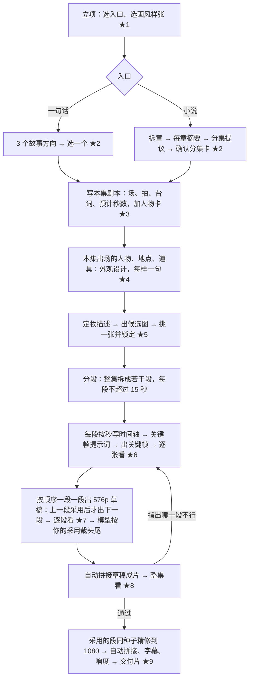
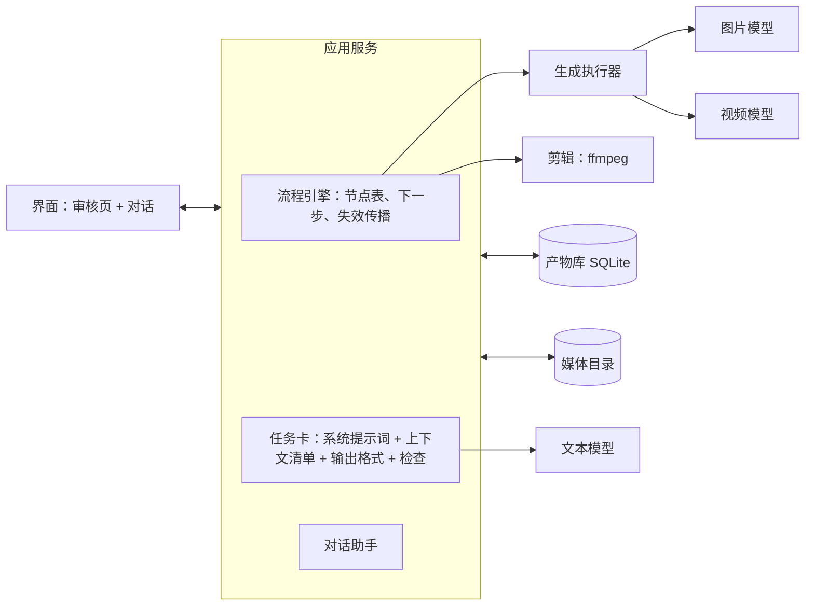

# 漫剧工作台：架构设计与方案（草案 v0.1）

日期：2026-10-27
状态：第 10 节的决定已全部定下（2026-10-27），可以按第 9 节开工。

工作名沿用目录名 yanxiang，产品名另定。

---

## 1. 结论

1. **验收单位是「一集」**。第一个里程碑只证明一件事：从一句话出发，产出一集约 2 分钟（96–144 秒）能看的成片；小说入口紧随其后。世界观、季规划、多集连续性都推到一集跑通之后。
2. **流程由代码写死，模型只做函数调用**。每次调用模型都不带工具、不进循环，输入由代码按「上下文清单」组装，输出有固定格式。对话助手只负责听懂用户的话，然后改某一步、重跑这一步，它不驱动流程。
3. **一次只写一件东西**：一张图的提示词、一段不超过 15 秒的视频、一集的剧本。「先框架后细节」放在层级之间做，即「集 → 段 → 秒」「人物 → 外观要点 → 定妆描述」，一张图内部不再拆成逐元素调用。
4. **先出一次，满意就钉死，钉死的是图**。模型对没给具体尺寸、长度的维度每次写得不一样，这个波动不靠事先把所有维度列全来消除（也列不全），而是出图后由用户挑一张锁定。之后所有用到这个人、这个地方、这件东西的请求，**只绑这张图作参考，不再带当初的提示词**，因为提示词本身有随机性（2026-10-27 定）。写手模型只写这一刻图里没有的东西：姿势、动作、表情、在画面哪里、和锁定图不同的状态。
5. **所有图和视频都由人看**（2026-10-27 定）。程序只做能确定的检查（时长、参考图数量、文件能不能打开），不用审查模型替人判图、选片。
6. **经验由你逐条审过再入库**。旧项目和 manju 的规则、技能先抽成一份审核清单给你看；你审过的，再清洗成新格式（描述、写法、措辞都重写），没审过的不进任何上下文。每条规则只放在一个地方。

---

## 2. 依据：manju 为什么一集都跑不出来

标注：**[核对]** 是看过源码、库或产物文件得出的；**[历史分析]** 来自之前的会话或 Claude Code 的分析，本次没有逐条复核。

| 你说的问题 | 证据 | 新设计里怎么处理 |
|---|---|---|
| 1. 旧经验脏，提示词冲突重复 | 旧项目 `.cursor/rules` 加 `.cursor/skills` 共 1,528,566 字节；写一条图片提示词前被要求读约 179 KB，视频约 147 KB，分镜关键帧约 297 KB [核对]。字数有三套标准叠在一起：门禁要求不少于 350 词，官方文档说对白多时别为了凑词数硬写，而用来定参数的那条真实提示词只有 162 词 [核对]。腰以上、无参考图的发型测试结论，被写成了全身照规则 [核对]。一条已提交的关键帧提示词约 3194 字符，`Primary request` 写抖开衣服，`Subject` 写举起叠好的衣服，场景物件写了两遍 [核对]。真正有对照组的实测只有约 9 条，大多是 H3 的速度和切点，加 GPT Image 发型测试 [核对] | 第 6.8 节：旧经验拆成审核清单，你逐条审过、再清洗重写才入库；每条规则只有一个归属 |
| 2. 上下文太大，不是最小充分 | **成立。** 视觉、分镜子 agent 拿到的上下文包中位约 6.0 万字，顶在代码上限 `BRIEF_LIMIT = 60_000` 上 [核对，`manju/src/engine/brief/brief.ts:17` + 会话统计]。设计师 agent 单次任务的峰值输入中位 8.2 万 token、最高 42 万 token；它还能自己调 `ManjuGet` 取数据，单次最多取回 62.9 万字 [核对，会话 usage]。9 个子 agent 共用同一份 19 个工具的清单，写视觉设定的 agent 也挂着出图、渲染、交付工具 [核对，`manju/src/runtime/agents.ts:19`]。两部试跑合计读入约 2.47 亿 token、写出约 310 万 [核对] | 第 6.1 节：每类任务一张上下文清单，写死在代码里；模型拿不到工具，没法自己去「多读一点」 |
| 3. AI 写提示词不全、省事 | **部分成立。** 一次任务确实太大：分镜单个任务最多新建 73–79 条，一套造型约 200 个待填的字符串 [核对]。省事有实例：`SHOT-EP001-024` 的景别只写「胸以上，靛青短夹与灰褐围裙，石柱暗面在背景」，同集第 1 镜写到了砖缝和裂口高度；`LOOK-GW-WORK` 里中衣和长裤的细节写成「无。」[核对，五百年锁中仙库]。但不是处处都短：定妆提示词中位仍有 5505–6158 字，同一集里后段镜头的景别只比前段短约两成 [核对]。系统提示词要求的是「把每个字段填满」，没有一条要求「画面上看得见的都要写，不管有没有字段」[历史分析，已对照源码]。**今天上午的实验**：最小上下文（每次读入约 5.3k token），单次只写一张定妆照的人物描写，你判断写得很详细；同样的任务拆成「先列框架再逐元素写」，读入 token 约为单次写的 60 倍 [核对，`/tmp/manju-granularity/run-1027-1126-clean/`] | 第 6.1、6.2 节：一次一件，系统提示词写清楚「看得见的都写，写到画风画得出的那一层」；第 6.3 节：钉死机制处理剩下的波动 |
| 4. 一上来就做长篇和多集 | **部分成立。** 第 4、5、7、8、9 次试跑全停在故事库阶段；第 9 次约 2.4 小时后因等消息超时退出；五百年锁中仙先写了 24 集才进第 1 集 [核对]。但后来有日志的两部试跑里，83% 的输入 token、73% 的子 agent 时间花在第 1 集的视觉设定、分镜、出资产图和归因上，两部都停在资产和分镜，没有一条视频任务 [核对]。也就是说，长篇前置拖慢了早期试跑，而后期没出片的主因是单集生产本身转不动 | 第 4、9 节：主线是一集；小说只抽取本集需要的东西，系列记忆推到 M4。单集生产转不动的原因见下两行 |
| 另外：单集生产循环转不动 | 工具调用 4853 次，出错 583 次（12%），其中约六成是参数不对；子 agent 有相当比例没跑完（设计师 89 次里 23 次、归因 31 次里 18 次），原因是被中断、轮数用完、接口 429/503 或超时 [核对，会话统计]。上游一改，分镜就整段过期重来 [核对] | 第 5 节：模型调用不带工具，没有「参数填错」这一类失败；第 7 节：失效只沿引用边传播 |
| 另外：导演在当流程引擎 | 导演挂 20 个工具，既要理解用户，又要派活、判断阶段、处理失败和重试 [核对，`manju/src/runtime/sessionRunner.ts:48`]。网络中断或审查分歧后，能不能接着做全看导演想不想得起来 [manju 文档 16] | 第 5 节：流程引擎是代码，对话助手不能出图、不能入队 |
| 另外：生成链路的硬缺陷 | manju 的缺陷清单列了 A–J 十类，其中状态矛盾写进提示词、上游改了不重做、重复扣费、审查放水都直接影响出片 [核对，`manju/docs/缺陷清单.md`] | 第 6.7、7 节：锁定版本 + 输入快照；提交后拿不到任务号就停下来问，不自动重提 |

---

## 3. 设计原则

1. **一集是验收单位**。场景、镜头、资产、提示词都只是做出一集的中间产物。
2. **流程是代码，模型是函数**。阶段顺序、能不能进下一步、出几张图、什么时候花钱，全由代码决定。模型调用是「输入 → 输出」，不带工具。
3. **一次只写一件东西**。一次调用只产出一张图的提示词、一段视频的时间轴、或一集剧本。
4. **最小充分上下文**。每类任务的输入清单写在代码里，只放这件东西需要的、已经定下来的事实。已经有视觉设定的地方不再塞剧本（你 10-27 的原话：「直接照着视觉设定写不就行了」）。
5. **系统提示词说清楚哪些要写详细**。每类任务一份系统提示词，规则只出现一次，不和别处重复。
6. **先出一次，满意就钉死**。锁定图是后面一致性的唯一来源；后面的请求只绑图，不带当初的提示词。
7. **经验由创作者审过才入库**。没审过的不进系统提示词，也不能拦生成。
8. **所有图和视频都由人看；新人只做选择题和说人话**。每个审核点都是「看样子挑一个」或「说哪里不对」，不需要看提示词。

---

## 4. 产品：用户和流程

### 4.1 用户

不会写提示词、不会剪辑、没做过分镜的新人。他能做的是：说清楚想要什么故事，看图看片时说出哪里不对，在几个候选里挑一个。

### 4.2 两个入口

- **一句话**：「一个被锁了五百年的男人醒来，发现封印他的人是自己的妻子」。
- **导入小说**：一部连载长篇（txt 或 epub），可能几十万到几百万字。

### 4.3 主流程



★ 是审核点。所有图和视频都由人看（2026-10-27 定），所以关键帧、每段草稿都要过人。新人在每个审核点看到的是图、片和中文说明，提示词收起来，想看可以展开。

| 审核点 | 看什么 | 怎么操作 | 为什么放在这里 |
|---|---|---|---|
| ★1 画风 | 3–4 张同一角色的画风样张 | 挑一张 | 画风错了后面全错；样张便宜 |
| ★2 故事方向 / 分集卡 | 每个方向一页；小说是分集卡列表（每集覆盖哪几章、核心事件、结尾钩子） | 挑一个，或说要改什么 | 故事是视频之前最便宜的一步 |
| ★3 本集剧本 | 按场读，每场标预计秒数；附人物卡 | 说意见，助手改 | 剧本定了，资产和分段才有输入 |
| ★4 外观设计 | 每个人物、地点、关键道具的外观要点，每样一句 | 说意见，助手改 | 出图前先定方向，比出完图再改便宜（2026-10-27 定） |
| ★5 定妆与场景 | 每个人物、地点、关键道具各 2 张候选 | 挑一张锁定，或说哪里不对重出 | 这一步定下一致性，之后只绑这张图 |
| ★6 关键帧 | 每段每个切点的关键帧 | 逐张通过，或说哪里不对重出 | 关键帧既钉切点又当参考，错了视频一定错；图比视频便宜 |
| ★7 段草稿 | 每段 576p 草稿，按顺序一段一段出 | 采用，或说哪里不对重出这一段；采用后下一段才开始出 | 草稿快，精修慢（见 6.5），先在草稿上把表演定下来；后一段要接前一段的尾巴 |
| ★8 草稿成片 | 拼好的整集草稿 | 指出哪一段不行、哪里不行 | 段与段放在一起才看得出节奏和接缝；只重做那一段 |
| ★9 交付片 | 精修后的整集 | 确认交付，或指出精修走样的段 | 所有视频都由人看 |

同类产品（即梦、LTX Studio、Story.com）都把审核放在出视频之前来省钱 [调研]。这里在出视频前有 ★1–★6，视频本身先看低清草稿再精修。

### 4.4 用户的意见怎么起作用

用户在任何审核点用自然语言说意见，例如「师父看起来太年轻了」。对话助手做两件事：判断这句话针对哪个产物（师父的外观要点），把它改写成一条明确的修改意见，再交给流程引擎重跑这一步。下游凡是引用了旧版本的产物，都按引用关系标成「需重做」。对话助手不能直接出图，也不能跳过审核点。

---

## 5. 架构

### 5.1 总图



### 5.2 模块

| 模块 | 负责 | 不做 |
|---|---|---|
| 流程引擎 `pipeline/` | 节点表写死在代码里；算出下一步能做什么；改了上游后沿引用边标记需重做；记录每一步的输入快照 | 不调模型写内容 |
| 任务卡 `tasks/<任务名>/` | 每类模型调用一个目录：`context.ts`（上下文清单：从库里取哪几样）、`schema.ts`（输出格式）、`checks.ts`（程序能确定的检查）；系统提示词读 `提示词/<任务>.md`（见 6.8） | 不访问清单之外的数据 |
| 产物库 `store/` | 每个产物一个版本一条记录，写入后不改；锁定状态；引用边 | 不推算业务规则 |
| 模型适配 `models/` | 文本、图片、视频模型各自的调用格式和提示词模板 | 不决定什么时候调 |
| 生成执行器 `jobs/` | 提交、轮询、下载；同一请求只提交一次；提交后拿不到任务号就标「结果不明」等用户处理 | 不自动重出 |
| GPU 连接 `gpu/` | H3 跑在租用的 GPU 上：连接、自检、把待出的视频攒成一批提交；开关机方式见第 10 节 | 不决定出哪些片 |
| 剪辑 `edit/` | 按段顺序拼接、字幕、响度、导出 | 不改剧本 |
| 对话助手 `assistant/` | 读当前状态，向用户解释；把用户的话变成对某个产物的修改意见；触发重跑 | 不能出图、不能入队、不能跳过审核点 |
| 规则登记 `rules/` | 每条规则的归属、证据、适用范围 | 不自动升级规则 |
| 界面 `ui/` | 九个审核点的页面、对话、进度 | 不自己推算状态，状态只从引擎读 |

依赖方向：`ui → app → (pipeline, tasks, assistant) → (store, models, jobs, edit)`，下层不引用上层。

### 5.3 为什么不用多 agent

manju 的试跑说明，让 agent 自己决定读什么、调哪个工具、什么时候停，会带来三个问题：上下文无上限地变大，流程靠模型记性，失败没法复现。这里每一步要做什么是事先知道的，用代码写死更合适。唯一需要「理解开放的话」的地方是对话助手，它也只有一个出口：生成修改意见。

---

## 6. 核心机制

### 6.1 任务卡：把「最小充分」落到代码里

每次模型调用只由三样东西组成：

```text
系统提示词（这类任务固定）
+ 用户消息（代码按上下文清单从库里取，只放这一件东西要的）
→ 输出（固定格式，程序校验）
```

上下文清单是代码，不是让模型去查。下面是每类任务的清单：

| 任务 | 一次产出 | 上下文里放什么 | 明确不放 |
|---|---|---|---|
| 故事方向 | 3 个方向，每个一页 | 一句话、题材、单集时长 | 世界观、季规划 |
| 章节摘要（小说） | 一章的事件、出场人物、状态变化、可拍的画面 | 这一章原文 | 其他章 |
| 分集提议（小说） | 前若干集的分集卡 | 各章摘要 | 原文 |
| 本集剧本 | 场、拍、台词、预计秒数；加一张人物卡（见下） | 分集卡或方向；小说入口再加本集覆盖的那几章原文 | 其他集、世界观全文 |
| 外观设计 | 一个人物 / 地点 / 道具的外观要点，每样一句（框架）；剧本没写外貌就由模型设计 | 人物卡里这个人的那一行；剧本里写到它外貌的原句（有才给）；题材；同集其他人物各一行主色和轮廓（为了一眼分开） | 名字以外的剧情、画风 |
| 定妆描述 | 定妆照提示词里描写这个人的那一段 | 外观要点 | 人物卡、剧本、画风、背景、构图、光（画风等由程序写） |
| 分段 | 整集分成若干段，每段覆盖哪几拍、多长、怎么接（框架） | 本集剧本、已锁定的实体名单 | 定妆描述 |
| 段时间轴 | 这一段从第 0 秒到结尾，每一秒发生什么、在哪一秒切镜（细节） | 这一段的拍、前后段各一句、出场实体名单、此刻状态 | 其他段的细节 |
| 关键帧描述 | 某一秒的静态画面：谁在画面哪里、什么姿势、什么表情、手里拿什么、和锁定图不同的状态 | 时间轴里那一秒、出场实体名单和各自对应第几张参考图、每人的主色和陈设数量（区分词用）、此刻状态 | 定妆描述（外观只由参考图管） |
| 视频提示词 | —— | 由程序编译：时间轴、台词、参考图编号对应关系 | 不由模型写，不带定妆描述 |

**人物卡**（2026-10-27 定）：剧本任务顺带产出，每个出场人物一行，只写影响长相的东西：性别、看起来多大、地位和门派（决定穿什么档次）、是主角配角还是龙套（决定美型和区分度）、本集要做的动作和要拿的东西（要拔刀腰上就得有刀）、性格一句（只影响神态）。名字以外的剧情不写，因为长相和剧情无关。

**实测参照**：今天上午的定妆照实验，用户消息只有四段（这张图要什么、外观意图 26 条、画风一行、口味 3 条），每次读入约 5.3k token，单次调用约 10 秒。这是第一张任务卡的样板。

**体量上限**：每次调用读入超过 8k token 时，程序报警并在日志里列出各段大小。8k 是拍的，依据是上面这次实验约 5.3k 再留余量；M0 用更多任务类型实测后校正。

### 6.2 系统提示词怎么写

所有提示词都用中文写（2026-10-27 定），包括系统提示词、给文本模型的用户消息，以及最后交给 GPT Image 和 H3 的提示词。

每份系统提示词统一分三段（2026-10-27 定）：

```text
# 你是什么
一句话说明身份和这份产出给谁用。

# 你要干什么
- 这次要写的是什么。
- 为什么要这样写（只写一次）。
- 要写详细的有哪些、写到什么程度。
- 不写什么。

# 输出是什么
格式、长度范围、示例（如有）。
```

以定妆照描述为例：

```text
# 你是什么
你是 3D 国漫剧的定妆照描写师。你写的这一段会直接交给图像模型出定妆照，后面所有镜头里这个人都照这张图画。

# 你要干什么
- 写这个人在这张定妆照里的样子：她站着、正面朝镜头时看得见的一切。
- 图像模型只认文字，你没写的地方它每次自己发挥，而且每次不一样。所以画面里看得见的都要写，不管外观要点里有没有提到；要点里只有一句的，顺着那个方向写到别人只看你的文字就能画出同一个人。
- 每样东西写清形状、大小（和身体哪里比）、材质、颜色深浅、在身上哪里、怎么穿怎么系；不要只给名词，也不要只给「精致」「华丽」这类形容词；写到这个画风画得出的那一层，不写毛孔、针脚。
- 左右写画面左右。
- 不写剧情、性格、比喻；不写画风、背景、构图、机位、光，这些程序另写。

# 输出是什么
一段中文正文，不要标题、列表符号和解释。
```

约束：同一条规则在一份系统提示词里只出现一次；一条规则如果已经由程序检查把守，就不再写进系统提示词。

**程序写的和模型写的严格分开**（2026-10-27 定）：定妆照、三视图、道具图、场景图这类图里固定不变的部分（画风、背景、构图、光）由程序按固定句写，模型只写主体那一段。系统提示词里明确不让模型写这几项；程序再用一张词表检查模型写的那段里有没有画风、背景、机位、光的说法，有就让模型重写这一段，最多 2 次（拍的），仍不过就显示给你。这样一张图的提示词里，每件事只有一个作者，不会出现模板句和模型句重复。

**否定怎么写**（2026-10-27 定）：不写泛泛的否定词，比如「不要照片感」「不要油光」。照片感、油光这类问题，靠把想要的样子正面写对来避免，例如写「哑光、冷中性肤色」。只有此刻确实不该出现在画面里的具体东西才写否定，例如「他身后没有门」「左手空着」。

**哪些地方要写详细，由系统提示词点名**（2026-10-27 定）：新系统不用字段表，所以各任务的系统提示词要逐项点名这一类画面里哪些地方必须写详细，例如定妆照的发型要写分缝或刘海、鬓边、结构、发饰、发尾等。按你审过的经验整理好的清单在 `docs/规则/经验规则.md`，按任务分节。每份系统提示词控制在约 1500 个中文字以内（拍的，以盲审结果校正）。

今天上午的实验是让模型写英文。改成中文后，M0 要重跑一遍定妆照，确认写得一样详细；M1 要确认 GPT Image 和 H3 对中文提示词的遵循程度，出了问题记下是哪个模型、哪类内容。

### 6.3 先出一次，满意就钉死

这是对你今天这条意见的展开。

**问题**：系统提示词写清楚后，模型写得够详细；但用户消息里没有给具体大小、长度的维度（袖子多宽、发冠多高、刀多长），每次写的都不一样。

**做法**：不在出图前把这些维度都定好，而是在出图后由人挑。

```text
外观要点（框架，你先审 ★4）
  → 写定妆描述（每次可能不同）
  → 出 2 张候选图（每张可以来自不同的描述）
  → 用户挑一张
  → 锁定这张图（连同模型和参数）；当初的描述只存档备查
```

**锁定之后怎么用**（2026-10-27 定：只绑图）：

- 下游任何请求里出现这个人物，只把锁定图作为参考图绑进去，**不再带当初的定妆描述**。理由：提示词有随机性，同一段描述再用一次也画不出同一张图；真正定下来的是那张图。
- 提示词里只用编号指认它（例如「参考图 1 里的女人」），由程序按绑定顺序生成这句对应关系。
- 写手模型拿到的是实体名单、各自对应第几张参考图、此刻状态，只写图里没有的东西：姿势、动作、表情、在画面哪里、手里拿什么、和锁定图不同的状态（受伤、衣服破了、刀出鞘）。它不会、也没有机会重新描述一遍这件衣服。
- 当初的定妆描述存档，只在改版时给写手当起点，或者给你查看。
- 要改锁定的东西，只能明确地出一个新版本；引用旧版本的关键帧、视频自动标成需重做。

**要在 M1 验证的一点**：只绑图、不写外观时，GPT Image 和 H3 能不能把参考图里的细节（发饰、腰间挂件、衣服纹样）保住。保不住的那类细节，记下是哪个模型、哪类细节，交你决定是加一张该部位的特写参考图，还是在提示词里点一句。

**一组图一个根**：人物的根是全身正面定妆照。脸部特写、侧面、背面、造型变体都用根图作参考改图得到，图和图之间不互相参考。外部项目 shuohao-skills 在 H3 上实测：只给全身正面时脸会走样，加一张正脸特写最接近 [调研，对方实测]。

**锁定顺序**（2026-10-27 调整）：画风样张 → 人物根图 → 造型 → 关键道具 → 地点主图 → 关键帧。后一层只能引用前一层已锁定的版本。关键道具排在地点主图前面，因为场景图里出现关键道具时要绑它的三视图。

**只绑图的例外**（2026-10-27 定）：下游不复述当初的描述，但允许写极短的区分词，因为旧项目实测只绑图时陈设数量会变、多人同框衣服会穿串。陈设写数量（「五把长老座」），多人同框时人名后加主色（「穿白袍的沈照雪」）。

**候选数**：每个锁定节点默认 2 张（拍的）。用户都不满意就说哪里不对，助手把这句话改成外观要点的修改，再出 2 张。

这个机制也回答了「表格不可能列全」：不需要事先列全。模型按系统提示词把看得见的都写出来，没给定的维度由它自己定；人在图上判断它定得对不对；对了就锁住图，之后不再变。

### 6.4 先框架后细节放在哪一层

| 层级 | 框架（一次调用） | 细节（每项一次调用） |
|---|---|---|
| 故事 | 3 个方向 / 分集卡 | 本集剧本 |
| 一集 | 分段：每段覆盖哪几拍、多长 | 每段按秒写时间轴 |
| 一个实体 | 外观要点，每样一句 | 定妆描述，一次写完整段 |

一张图内部不再拆成逐元素调用。今天的实验里，逐元素写的读入量约为单次写的 60 倍；而单次写在系统提示词写清楚后已经足够详细（你的判断）。如果盲审结论是逐元素写的明显更好，再把它作为可选模式加回来。

### 6.5 视频（H3，2026-10-27 定）

- 每段按内容定长，最长 15 秒（你已定），段内按秒写（你已定）。一集约 2 分钟，按每段 8–15 秒推算是 7–18 段（由时长推导）。
- 段内在哪一秒切镜由时间轴决定；每个切点钉一张关键帧。H3 上文戏实测：同一提示词、两颗种子，不钉帧切点漂到 5.08–5.38 秒和 8.54–8.71 秒，钉帧后都落在 5.00 和 9.00 [核对，旧项目 `config/benchmarks/r3-structure-a.jsonl`]。打戏没在钉帧下测过，M1 里测。
- **按顺序一段一段出**（2026-10-27 定）。上一段草稿采用后才出下一段，下一段接的就是已采用的那条尾巴。整集草稿拼好后（★8）如果要重做中间某一段，接在它后面的段会被标成需重做，再按顺序重出。
- **段与段的承接：重放上一段末尾几帧**（2026-10-27 定；你看片的判断是接缝比首尾帧好得多）。做法照旧项目：上一段末尾 22 帧连声音切出来，作为下一段的引导片段钉在第 0 帧；下一段开头约 0.92 秒是重放，剪辑时剪掉 [核对，`h3_profile.json` 91 行]。22 帧是旧项目定的值，M1 沿用。换了地点的下一段不重放，直接切（2026-10-27 定）。用这个方式就能留在参考模式里，人物继续由参考图管（H3 的参考模式和首尾帧模式不能同时用 [调研，MiniMax API 文档]）。
- **先出低清草稿，再同种子精修**（2026-10-27 定）。每段先出 576p 草稿给你看（★7、★8），采用的段再用同一颗种子精修到 1920×1088。精修的做法照旧项目：第一遍和草稿完全相同，再把潜空间放大 1.875 倍、只重做最后几步，关键帧在放大后再钉一次 [核对，`h3_profile.json` 212–220 行]。旧项目记录不钉帧时轻档（重做强度 0.45）保住了草稿的姿势和表情，约 396 秒一条（n=2），但没有留下测量文件；同种子能否复现、钉帧版精修都没跑过 [核对，`h3_profile.json` 113–114 行]。你定了不专门比对（2026-10-27），精修后的整集照常在 ★9 由你看。
- 速度参考（5090，n=2）：576p 草稿八步约 165–184 秒，四步约 93 秒；精修到 1080 约 396 秒；关掉稀疏注意力约慢一倍 [核对]。这些只是速度，画质差异没有测量。一集 7–18 段，按八步草稿估算全集草稿约 20–55 分钟 GPU 时间，精修再加约 45–120 分钟（由上面的数推导，不含重出）。
- **闪白、顿帧、冲击帧、转场、快切这类手法写进段时间轴**（2026-10-27 定），由 H3 在段内直接生成，剪辑不再另做。用不用、怎么用，以及轴线、景别这类分镜手法，都交给模型按怎么拍好决定，系统提示词不另设规矩（2026-10-27 定）。
- 视频提示词由程序编译，不由模型写：时间轴原文 + 台词 + 参考图编号对应关系，不带定妆描述（外观只由参考图管，见 6.3）。旧项目 H3 提示词把外观写了三遍、还有记账用的段落 [核对]，新模板里一遍都不写。
- 声音：H3 原生出声。人物音色用参考音频固定（旧项目做法），具体在 M1 定。
- 出片不合格不自动重出，进待处理，由用户决定。

### 6.6 剪辑

不让用户剪辑。程序按段的顺序拼接，台词生成字幕，响度统一到 -15 LKFS（创作者 2026-10-24 已定）。草稿和精修各拼一次。用户在草稿成片审核时指出哪一段不行，只重做那一段（以及接在它后面的段，见 6.5），再重新拼。

**裁头尾**（2026-10-27 定：你审完，模型切）：H3 生成的段开头常有 0.3–0.8 秒发呆或形变，结尾动作做完后空转、嘴还在动（旧项目观察，见经验审核 06-23）。你在 ★7 采用一段后，由视觉模型看这一段，给出入点和出点：剪掉开头的重放部分和发呆，剪掉结尾的空转。程序按这两个点裁。模型只决定裁哪里，不决定这一段用不用，用不用由你定。裁的结果在 ★8 的整集草稿里能看到，不对就在那里指出来。

**交付分辨率**（2026-10-27 定：视情况，720p 和 1080p 都行）：立项时选。H3 精修出来是 1920×1088：选 1080p 时上下各裁 4 像素，不缩放；选 720p 时先裁到 1920×1080 再缩放到 1280×720。裁和缩放的做法是我定的默认，你有意见再改。

### 6.7 检查：程序查能确定的，图和视频由人看

所有图和视频都由人看（2026-10-27 定），不用审查模型判图、选片、打分。唯一用到视觉模型的地方是你采用一段之后给它裁头尾（见 6.6）。程序只在出图、出片前后做能确定的检查，不过就不送去生成，或者在审核页上标出来：

- 台词逐字出现在提示词里；段长不超过 15 秒；整集时长在 96–144 秒。
- 参考图数量不超过模型上限；绑的都是当前锁定版本。
- 生成结果文件能打开，分辨率、时长、帧数和请求一致，有声音。
- 精修片和草稿的时长、切点一致。

用户采用之前，程序不替他采用任何东西。

### 6.8 经验与提示词（2026-10-27 重写）

**两样东西分开放**

| | 位置 | 是什么 | 进不进模型上下文 |
|---|---|---|---|
| 经验规则 | `docs/规则/经验规则.md` | 知识来源：旧项目和 manju 的经验经你逐条审定后的定稿，按任务分节，每节分描写要求、设计规范、创作者口味、程序 | 不进 |
| 系统提示词 | `提示词/<任务>.md`，每个任务一份 | 发给模型的正文，文件里只有正文，没有编号、出处、注释 | 进 |
| 覆盖表 | `docs/提示词覆盖表.md` | 每份提示词用了经验规则的哪几条，每条程序规则落在哪段代码 | 不进 |
| 新经验 | `docs/规则/新经验.md` | 对话助手从你的审核意见里整理出的候选经验，等你决定是否并入 | 不进 |

提示词由人按规则写成，不由程序从规则文件自动拼接。这样规则里的证据、编号、审核痕迹不会混进提示词；提示词的措辞也能按模型写作的需要单独打磨。

**把规则写进提示词的组织方法**

1. **按模型写作的顺序组织，不按规则文件的分节。** 顺序是：你是什么 → 这次写什么、为什么要写全 → 按画面从整体到局部列出要写的内容 → 写法 → 不写什么 → 输出格式。
2. **一个任务只放它用得到的条目。** 设计类规则（宗门服制、怎么和同场人物区分）放进外观设计；描写类规则（发型写到哪几处、腿部写什么）放进描述任务。两个任务都要用的才两边都放。
3. **改写成指令。** 去掉编号、证据和旧项目背景；同一个写法要求全篇只说一次，例如「每一处写清形状、大小、材质、颜色、位置」一句管全篇。
4. **口味写成这部剧的设计要求**，放进对应的位置，不单列「口味」标题。
5. **标「程序」的条目不进提示词**，由代码执行。
6. **保留规则里的短例子**（「过道两侧各三条」「无刘海」），帮模型把握写到什么程度。
7. 每份控制在约 1500 字以内（拍的，M0 盲审后校正）。

**改动怎么走**

- **规则改了**：从覆盖表找到用了这条的提示词，人工改提示词，再更新覆盖表。程序检查两件事，有一项不满足就报错，不静默放过：覆盖表引用的条目在规则文件里都存在；规则里每一条都至少落在一份提示词或一段代码里。
- **新经验**（2026-10-27 定：单独存，不自动进提示词）：你在审核点说的意见，默认只改这一次的产物。你说「以后都这样」时，对话助手把它整理成一条，写明出自哪次审核、你的原话、建议放进经验规则的哪一节，存进 `docs/规则/新经验.md`。这个文件和经验规则分开，不进任何提示词，也不参与覆盖表检查。什么时候并入、怎么改写进提示词，由你决定后人工做。程序不自动总结经验，不自动加规则，不自动改提示词。
- **版本**：每次模型调用记下所用提示词文件的版本。提示词改了，已锁定的图和已采用的片不受影响，只有之后新生成的按新提示词来。

**经验的来源**：旧项目和 manju 的规则、技能、经验库，按领域拆成审核清单（`docs/经验审核/`），你逐条审定后清洗成定稿。原文件不改动，只作出处。

### 6.9 小说改编

```text
导入 → 程序按章切分 → 每章一次调用写摘要（只读这一章）
→ 一次调用读全部摘要，提议前 N 集的分集卡 → 用户确认（★2）
→ 只展开第 1 集：剧本任务读第 1 集的分集卡 + 它覆盖的那几章原文
```

- 分集按局势变化切，不按章或字数均分；一章可以拆成几集，几章也可以合成一集。公开的方法都这么说，而且都写明「一集对应多少原文」没有稳定公式 [调研：Dramily、ZenStory]。
- 分集卡写清：覆盖哪几章、本集核心事件、删了哪条支线、哪段内心独白改成了什么看得见的动作、结尾钩子。新人只需审这些取舍。
- 摘要很长时（几百章），先按卷合并摘要再提议分集（按章节树自底向上合并，比平铺切块更连贯 [调研：ToM，EMNLP 2025]）。第一版只支持到提议前 10 集（拍的）。

### 6.10 连续剧（M4 才做）

第一版只做两件事：

- **资产复用**：第 2 集直接引用第 1 集已锁定的人物、地点、道具。
- **集末交接卡**：第 1 集完成后，一次调用读第 1 集剧本，写出集末状态（谁受了伤、谁知道了什么、东西在谁手里、留下了什么悬念），用户确认后作为第 2 集剧本任务的上下文。

伏笔管理、跨集推理、季规划都不在第一版。

---

## 7. 数据模型

第一版只要几张表：

```text
project      项目：入口类型、画风、单集时长
source       小说原文和按章切分的结果（只有小说入口有）
artifact     所有产物：id、kind、所属实体、version、status、payload、input_digest、created_by
edge         引用关系：哪个产物的哪个版本用了哪个产物的哪个版本
job          生成任务：请求快照、提交状态、服务方任务号、结果
media        图片和视频文件：hash、路径、尺寸、时长
rule         规则登记（6.8）
decision     用户在审核点的每一次决定和原话
```

`artifact.kind` 第一版只有：`direction`、`chapter_summary`、`episode_card`、`script`、`entity_brief`（外观要点）、`entity_lock`（锁定图 + 模型和参数；当初的描述只存档）、`segment_plan`、`segment_timeline`、`keyframe`、`clip`、`cut`、`handoff`。

`artifact.status`：`draft`（写好了）→ `candidate`（出了图等挑）→ `locked`（用户挑定）→ `stale`（上游变了，需重做）。写入后不修改，改动就是新版本。

`input_digest` 记这一步读了哪些产物的哪个版本。上游出新版本时，沿 `edge` 找到受影响的下游，只标这些为 `stale`，不按类型全项目扩散（这是 manju 缺陷清单 B4 的教训）。

---

## 8. 从旧系统带什么（2026-10-27 定：全新写）

代码一行不复制。模型调用部分可以**参考**旧实现（接口参数、鉴权、轮询方式），在新仓库里重写。

| 来源 | 参考 | 不用 |
|---|---|---|
| manju | 图片模型调用（`src/models/gpt-image/`）的接口参数和鉴权方式 | 其余全部代码、数据模型、技能、提示词 |
| tianyanzhizhu | H3 的 ComfyUI 工作流和调用方式（`tools/manju/` 里的 H3 适配器、`h3_workflow.py` 的钉帧节点） | 提示词门禁代码 |
| manju 的教训（不是代码） | 提交后拿不到任务号就停下来问；不替用户采用；不自动重出；过期沿引用边传播 | —— |
| 两边的规则和经验 | 经你逐条审过、再清洗的条目（6.8） | 没审过的 |
| 今天的实验 | 定妆照的系统提示词结构和上下文清单，作为第一张任务卡的样板 | —— |

参考旧调用代码时，对照 manju 缺陷清单 C 类（重复扣费、自动重提、下载失败卡死）逐条在新实现里规避。

---

## 9. 里程碑

每个里程碑以验收结果为准，不按天排期。

### M0：写手定型（只调文本模型，不花生成费）

- 先审第一批旧经验（人物外观、场景道具、关键帧的描述写法，画风和口味），清洗后作为各任务系统提示词的规则来源。
- 把今天的定妆照实验扩到：地点主图、关键道具、一段的时间轴、一张关键帧。
- 每类任务定下系统提示词和上下文清单。
- 每类各跑 3 次，看同一输入下哪些维度在变；变化大的维度如果影响剧情（例如刀的长短决定能不能藏进袖子），就补进外观要点，不影响的留给钉死机制。

验收：你盲审每类任务的输出，认可「写得够详细」。

### M1：一段样片（花少量生成费）

- 输入是一段手写的剧本，要有一定复杂度（2026-10-27 定：台词、动作、特效、地点、道具、状态变化都要多一点）。初定规格如下，数字都是拍的，写剧本时按内容微调：
  - 时长 45–60 秒，约 4–6 段。
  - 3 个人物，其中至少两人有对手戏。
  - 2 个地点，中间有一次转场。
  - 3–4 件道具，至少一件在片中被拿起、交出或损坏。
  - 6–8 句台词，分给至少两个人，有一处两人来回对话。
  - 至少一段动作戏（打斗或追逐），一段文戏。
  - 1–2 处特效（例如法术光效、剑气、符阵）。
  - 3 处以上状态变化（例如受伤见血、刀出鞘、锁链断开、衣服破损），并且变化前后都要出现在画面里。
- 旧项目里打戏、特效都没在钉帧下测过 [核对，`h3_profile.json` 113 行]，这个样片正好覆盖它们。
- 走完：外观要点 → 定妆描述 → 出图挑选锁定 → 分段 → 时间轴 → 关键帧 → 每段 576p 草稿（同一地点内后一段重放前一段末尾 22 帧；转场处不重放）→ 拼草稿 → 同种子精修 → 拼交付片。
- 顺带测没验证过的事：只绑图、不写外观时，GPT Image 和 H3 保不保得住参考图里的细节；打戏和特效在钉帧下切点准不准、动作清不清楚；状态变化前后画面对不对得上；同一参考音频跨两段像不像同一个人；台词口型。每项同一输入、两颗种子、一次只改一个变量（旧项目里唯一站得住的实测方法）。

验收：你认为这段样片能看；每一处失败都能说出是哪一步、哪个输入造成的。

### M2：一句话到一集

- 加上故事方向、本集剧本、整集分段、成片审核和单段重做。
- 单集目标时长约 2 分钟，上下不超过两成，即 96–144 秒（2026-10-27 定）。程序检查剧本预计总秒数和成片实际时长都落在这个范围。

验收：从一句话出发，你只在 9 个审核点操作，得到一集交付片。

### M3：小说到第 1 集

- 加上导入、拆章、章节摘要、分集卡。
- 用一部真实的连载小说做样本。

验收：分集卡你认可；第 1 集成片通过。

### M4：第 2 集

- 资产复用、集末交接卡。

验收：第 2 集不重新设计已出场的人物，人物在两集里是同一个人。

---

## 10. 决定

### 10.1 已定（2026-10-27）

| 事项 | 决定 |
|---|---|
| 产品形态 | 本机单人使用，无账号 |
| 仓库 | 新仓库全新写，不用任何旧仓库的东西；模型调用可以参考旧实现 |
| 视频模型 | H3（自部署，租 GPU） |
| 单集时长 | 约 2 分钟，上下不超过两成（96–144 秒） |
| 入口顺序 | 先做一句话到一集（M2），再做小说导入（M3） |
| 技术栈 | TypeScript（Bun）。创作者说都行；选它是因为网页前后端同一种语言，H3 走 ComfyUI 的 HTTP 接口、剪辑调 ffmpeg 命令行，都不需要 Python |
| 界面形式 | 本机网页（本地服务 + 浏览器）；跑通后再考虑桌面端 |
| GPU 开关 | 你手动开关机，程序只管连接和自检（沿用 2026-10-24 的决定） |
| 图片模型 | GPT Image（经 Yir） |
| 钉死之后 | 只绑锁定图，不再带当初的提示词（提示词有随机性） |
| 审核 | 所有图和视频都由人看，不用审查模型判图 |
| 旧经验 | 抽成审核清单由你逐条审；审过的再清洗（描述、写法、措辞重写）后入库 |
| H3 承接 | 重放上一段末尾 22 帧（接缝比首尾帧好得多，你看片的判断） |
| H3 出片 | 第一版先出 576p 草稿，采用的段再同种子精修到 1080 |
| 系统提示词格式 | 统一三段：你是什么、你要干什么、输出是什么 |
| 提示词语言 | 全部中文，包括交给 GPT Image 和 H3 的提示词 |
| M1 样片 | 不要太简单：台词、动作、特效、地点、道具、状态变化都多一点（具体规格见第 9 节 M1） |
| 出片顺序 | 按顺序一段一段出，上一段采用后才出下一段 |
| 裁头尾 | 你审完采用，视觉模型给入点出点，程序裁 |
| 剪辑手法 | 闪白、顿帧、冲击帧、转场等写进段时间轴，由 H3 在段内生成 |
| 交付分辨率 | 视情况，720p 和 1080p 都行，立项时选 |
| 精修比对 | 不专门比对草稿和精修 |
| 否定写法 | 不写泛泛的否定词，靠正面描述；只对此刻不该出现的具体东西写否定 |
| 详细写哪些 | 由各任务的系统提示词逐项点名，清单见 `docs/规则/经验规则.md` |
| 只绑图的例外 | 允许极短区分词：陈设写数量，多人同框时人名后加主色 |
| 关键道具三视图 | 场景图里出现关键道具时绑它的三视图 |
| 锁定顺序 | 画风样张 → 人物 → 造型 → 关键道具 → 地点主图 → 关键帧 |
| 外观设计 | 剧本没写外貌时按人物卡由模型设计；外观要点出图前先给你审（★4） |
| 提示词分工 | 定妆照这类图的固定部分由程序写，模型只写主体，程序检查越界 |

全部决定已定，下一步按第 9 节从 M0 开始。
