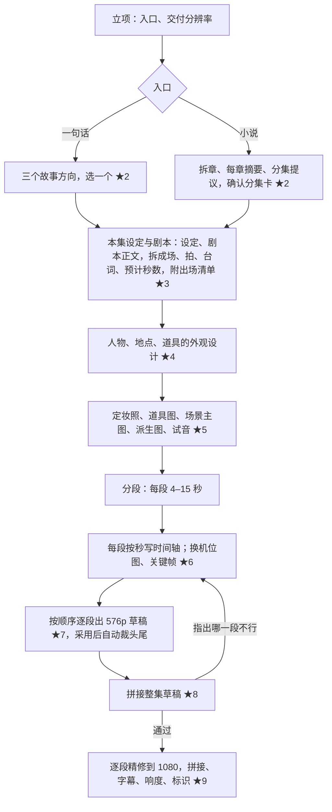

# 01 产品

## 用户

不会写提示词、不会剪辑、没做过分镜的新人。他能做的是：说清楚想要什么故事，看图看片时说出哪里不对，在几个候选里挑一个。本机单人使用，无账号。

## 入口

- **一句话**（先做）：例如「一个被锁了五百年的男人醒来，发现封印他的人是自己的妻子」。
- **导入小说**（后做）：一部连载长篇，txt 或 epub，几十万到几百万字。

做的是红果式的连载竖屏短剧：一部几十集，一集只是其中一个节拍，讲一件事，停在结果出来之前的卡点上；觉醒、打脸、倾心这些看点在后面各集慢慢兑现，不塞进一集（创作者 2026-10-28，依据见 [红果短剧单集写法](../调研/红果短剧单集写法.md)）。一句话入口现在只产出第 1 集，全剧分集大纲和后续各集留到 M4 之后。

第一版画风固定为 3D 国漫、题材固定为仙侠。立项时只选交付分辨率（720p 或 1080p）。风格参考图由画风插件自带一张（没有人、没有字的场景），不让用户挑：同一句画风句出的样张风格一样，挑的只是内容，而参考图里的内容会被带进新图。原来的 ★1 因此取消，其余审核点保留原编号。

## 主流程

## 审核点

所有图和视频都由人看。新人在每个审核点看到的是图、片和中文说明，提示词默认收起。出图、出片前都要用户点「开始」。

| 审核点 | 看什么 | 怎么操作 |
|---|---|---|
| ★2 故事方向 / 分集卡 | 每个方向一页：全剧梗概、主角处境、对抗、第 1 集那件事、卡点、全剧看点；小说入口是分集卡列表 | 挑一个，或说要改什么 |
| ★3 本集设定与剧本 | 本集设定一页（世界一角、规则、人物、真相、地点、独有时刻）；剧本按场读，每场标预计秒数；附出场清单（人物卡、地点、关键道具） | 通过，或说意见；对设定的意见会连带重写剧本 |
| ★4 外观设计 | 每个人物、地点、关键道具的外观要点 | 通过，或说意见 |
| ★5 定妆与场景 | 每个人物、道具、地点各 2 张候选；三视图、脸部特写；有台词人物的试音 | 挑一张锁定、通过派生图、选音色，或说哪里不对重出 |
| ★6 关键帧 | 每段需要的换机位图、每个切点的关键帧 | 逐张通过，或说哪里不对重出 |
| ★7 段草稿 | 每段 576p 草稿，按顺序逐段出 | 采用，或重出这一段 |
| ★8 草稿成片 | 拼好的整集草稿，带字幕 | 通过，或指出哪一段不行 |
| ★9 交付片 | 精修后的整集和交付检查结果 | 确认交付，或指出精修走样的段 |

★2–★6 都在出视频之前，图比视频便宜；视频先看低清草稿再精修。

## 用户意见怎么起作用

用户在任何审核点用自然语言说意见，例如「师父看起来太年轻了」。对话助手判断这句话针对哪个产物，写成修改操作和一句确认语；用户确认后，引擎带着这条意见重跑对应的一步，下游沿引用关系标成需重做（见 04、09）。意见只作用于这个项目里的这个产物，不会改提示词。
