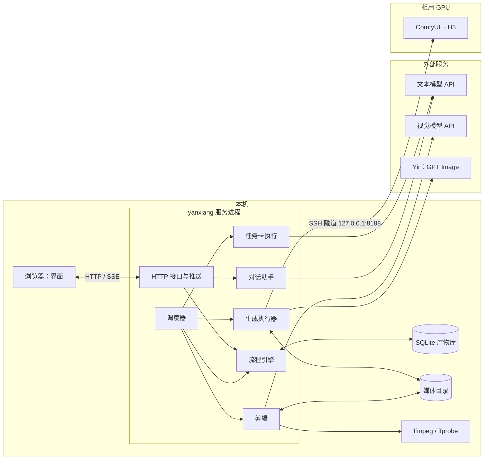

# 02 架构

## 一、进程与部署

单机、单进程。一个服务进程（用 Bun 运行，代码保持 Node 兼容）同时提供网页、HTTP 接口、推送事件，并在进程内跑调度和执行器。视频模型 H3 跑在租用的 GPU 上，经 SSH 隧道访问。



- **为什么单进程**：只有一个人在本机用，没有并发用户；单进程省掉进程间通信，调度和执行器直接读写同一个 SQLite（WAL 模式）。
- **调度器**：每 2 秒（拍的）扫一次可执行节点，按资源池派活。资源池和并发上限见下表，上限都是拍的，M1 后按实测调整。

| 资源池 | 并发 | 用于 |
|---|---|---|
| 文本模型 | 4 | 所有任务卡调用 |
| 视觉模型 | 2 | 裁头尾 |
| 图片 | 4 | GPT Image 出图和改图 |
| 视频 | 1 | H3（一台 GPU 一次一个工作流） |
| 剪辑 | 1 | ffmpeg 拼接、字幕、响度 |

- **启动恢复**：进程启动时先做恢复，再开调度（见 04、06、07）。

## 二、代码目录

```text
yanxiang/
  src/
    server/        HTTP 路由、推送事件、静态网页
    pipeline/      节点表、调度器、推进、审核决定、失效传播
    tasks/         任务卡：每个任务一个文件（上下文清单、输出格式、检查）
      runner.ts    任务卡执行：组装提示词、调模型、校验、重试、落库
      prompt.ts    系统提示词组装（占位符替换）
    store/         SQLite 打开、迁移、各表读写
    models/
      llm.ts       文本模型客户端
      vision.ts    视觉模型客户端
      yir.ts       GPT Image（Yir）适配器
      h3/          ComfyUI 客户端、H3 工作流图构建
    jobs/          生成执行器：提交、轮询、下载、恢复
    gpu/           GPU 连接检查、预检
    edit/          裁剪、拼接、字幕、响度、标识、交付检查
    assistant/     对话助手
    compose/       图片提示词拼装、视频提示词编译
    plugins.ts     插件发现与校验
  ui/              网页界面
  config/
    prompts/
      tasks/       每个任务一份系统提示词
      image-types/ 每类图的固定部分（背景、构图、光）
    plugins/
      style/3d-guoman/   画风插件：plugin.json、writer.md、character.md、image/<对象>.md、style-ref.png
      genre/xianxia/     题材插件：plugin.json、character.md、prop.md、describe.md
  docs/
  data/            项目数据（每个项目一个目录：project.db、media/）
```

## 三、模块边界

| 模块 | 对外提供 | 依赖 | 不做 |
|---|---|---|---|
| `pipeline` | `tick()`、`decide(review, decision)`、`revise(target, instruction)`、`status(project)` | store、tasks、jobs、edit | 不调模型写内容 |
| `tasks` | `run(task, scope, options) → artifact` | store、models/llm、prompt | 不访问清单之外的数据，不决定下一步 |
| `compose` | `imagePrompt(type, parts)`、`videoPrompt(segment)` | store（只读）、提示词文件 | 不调模型 |
| `jobs` | `enqueue(request)`、`recover()`、执行循环 | store、models/yir、models/h3、gpu | 不判断结果好坏，不自动重出 |
| `edit` | `trim(clip)`、`assemble(episode, stage)`、`deliver(cut)` | store、models/vision、ffmpeg | 不改剧本、不改时间轴 |
| `assistant` | `handle(utterance, reviewContext) → action` | store（只读）、models/llm、pipeline | 不出图、不入队、不改提示词 |
| `plugins` | `load() → {styles, genres}`、`fragment(plugin, key)` | 文件系统 | 不含业务逻辑；缺文件就不加载 |
| `store` | 各表的读写函数 | SQLite | 不含业务规则 |
| `server` | HTTP 接口、推送 | pipeline、assistant、store | 不自己推算状态 |

依赖方向：`server → (pipeline, assistant) → (tasks, compose, jobs, edit) → (store, models)`，下层不引用上层。

## 四、不用多 agent

manju 的试跑说明，让 agent 自己决定读什么、调哪个工具、何时停，会让上下文无上限变大、流程靠模型记性、失败无法复现。这里每一步要做什么是事先知道的，用代码写死；模型调用都是不带工具的单次调用。

## 五、技术选型

| 项 | 选择 | 说明 |
|---|---|---|
| 语言与运行时 | TypeScript；用 Bun 运行，代码只用 Node 标准接口 | 前后端同一种语言；以后做桌面端（Electron，跑在 Node 上）时后端代码可以直接搬进去 |
| 存储 | SQLite（`node:sqlite`，WAL）+ 本地媒体目录 | 每个项目一个库文件；`node:sqlite` 在 Bun 和 Electron 里都可用（manju 实测） |
| 输出校验 | zod | 模型的结构化输出都过 schema |
| 界面 | 本机网页，服务端推送用 SSE | 跑通后再考虑桌面端 |
| 文本模型 | 用户自己配置 | 见下方「模型配置」 |
| 视觉模型 | 用户自己配置 | 只用于裁头尾 |
| 图片模型 | GPT Image，经 Yir | 适配器参考 manju 的实现重写 |
| 视频模型 | H3，自部署 ComfyUI | 工作流图参考旧项目 `h3_workflow.py` 重写；GPU 由用户手动开关机 |
| 剪辑 | ffmpeg、ffprobe 命令行 | |
| 密钥 | macOS 钥匙串；Yir 的密钥暂时读环境变量 `IMAGE_API_KEY`（用户决定，`config/models.json` 的 `image.keyEnv`） | 不写进配置文件 |

## 六、模型配置

文本模型和视觉模型由用户在设置页里配置，存在 `config/models.json`，密钥存钥匙串。

```json
{
  "providers": {
    "main": { "protocol": "openai", "baseUrl": "https://…", "keyRef": "yanxiang/main" },
    "alt":  { "protocol": "anthropic", "baseUrl": "https://…", "keyRef": "yanxiang/alt" }
  },
  "text":   { "provider": "main", "model": "…" },
  "vision": { "provider": "main", "model": "…" },
  "tasks": {
    "script":      { "provider": "alt", "model": "…" },
    "trim":        { "provider": "main", "model": "…" }
  }
}
```

- `protocol` 支持 OpenAI Chat Completions 和 Anthropic Messages 两种接口，覆盖常见的模型网关。
- `text` 是所有文本任务的默认模型，`vision` 是裁头尾的默认模型；`tasks` 里可以给单个任务另配模型，键是任务提示词的文件名（见 05）。
- 每次调用的实际模型记进 `llm_call.model`，换了模型之后能对比前后的输出。
- 设置页提供「测试连接」：用一句固定的话调一次，确认地址、密钥、模型名都对。
- 没配文本模型时，所有文本任务停在 `queued`，界面提示去设置页配置。
- 每次请求都带一个随机的调用 id（Anthropic 接口放 `metadata.user_id`，OpenAI 接口放 `user`）。七牛网关对一字不差的请求会直接返回缓存（2026-10-27 实测：0.2 秒返回同一段文字），不加的话「重写」「重出」会拿回同一份结果。
