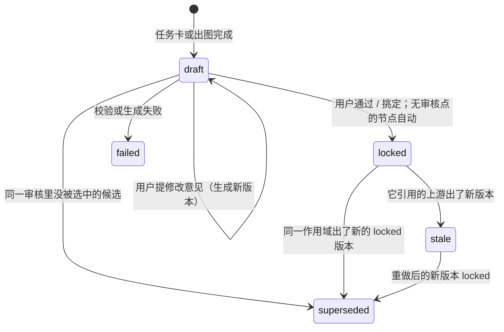
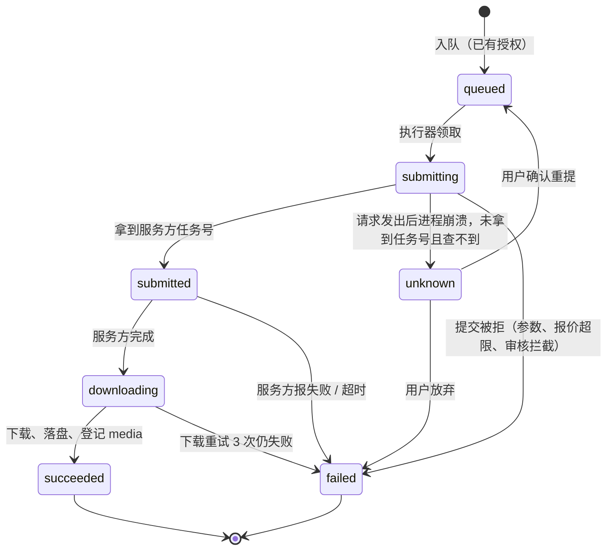
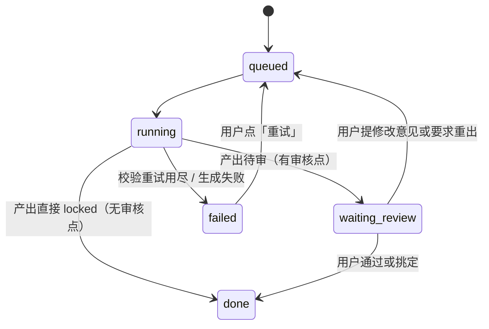

# 03 数据模型

每个项目一个目录 `data/<项目>/`：`project.db`（SQLite）和 `media/`（按 sha256 存文件）。

## 一、表

```text
project    id, name, entry('idea'|'novel'|'script'), style(插件 id), genre(插件 id), seconds_min, seconds_max,
           delivery('720p'|'1080p'), created_at
episode    id, project_id, number, created_at
entity     id, project_id, kind('character'|'location'|'prop'), name, first_episode_id
artifact   id, project_id, kind, scope, version, status, payload(JSON), media_id,
           input_digest, prompt_version, node_run_id, created_by('model'|'user'|'program'),
           created_at
           UNIQUE(kind, scope, version)
edge       from_id, to_id                     to 的生成用到了 from（两边都是具体版本）
node_run   id, node, scope, status, attempt, error, started_at, ended_at
llm_call   id, node_run_id, task, model, prompt_version, system_text, user_text,
           response_text, tokens_in, tokens_out, ms, ok, error, created_at
job        id, node_run_id, kind('image'|'video'), provider('yir'|'comfyui'), request(JSON),
           request_hash, idempotency_key, status, provider_job_id, attempts, error_code,
           error, cost, gpu_seconds, output_media_id, created_at, submitted_at, finished_at
media      id, sha256, path, mime, width, height, duration_s, frames, has_audio, created_at
review     id, point(1..9), scope, artifact_ids(JSON), status('open'|'closed'), opened_at, closed_at
decision   id, review_id, action, artifact_id, utterance, instruction, created_at
permit     id, scope, pool('image'|'video'), count, used, granted_at   用户点「开始出图/出片」的授权；作用域覆盖它下面的子作用域
```

`entry = 'script'` 是 M1 的手写剧本入口：剧本和出场清单由用户提供，直接以 `locked`、`created_by = 'user'` 入库（`src/m1/init.ts`）。表结构和读写在 `src/store/`。

**`scope`**（作用域键）把产物定位到它属于的对象，例如：

| 作用域 | 例子 |
|---|---|
| 项目 | `p` |
| 集 | `e1` |
| 集内实体 | `e1/char/沈照雪`、`e1/loc/石殿`、`e1/prop/宗主令` |
| 实体的派生图 | `e1/char/沈照雪/三视图`、`e1/loc/石殿/反打` |
| 段 | `e1/s3` |
| 段内切点 | `e1/s3/c2` |

实体锁定后跨集复用：第 2 集引用第 1 集已锁定的 `entity_lock`，不重新设计（M4）。

## 二、产物类型

| kind | 作用域 | 来源 | payload 主要字段 |
|---|---|---|---|
| `style_ref` | 项目 | 立项时由程序取画风插件的 `styleRef`，直接 locked | `plugin`、`file` |
| `direction` | 集 | 故事方向任务 | `title`、`logline`、`strategy`、`opposition`、`cost`、`payoff`、`opening` |
| `script` | 集 | 剧本任务 | `scenes[{id, location, beats[{id, action, lines[{speaker, text}], seconds, changes[]}]}]`；`changes` 是这一拍里变了的状态，「此刻状态」由程序按拍累加 |
| `roster` | 集 | 剧本任务同时产出 | `characters[{name, gender, age_look, rank, tier, needs, temperament}]`、`locations[{name, beats}]`、`props[{name, beats, key}]` |
| `entity_brief` | 集内实体 | 外观设计任务 | `lines[{part, text}]`；人物另有 `主色`、`区分` 两行，供同集其他人物区分和关键帧的区分词使用 |
| `entity_desc` | 集内实体 | 定妆描述、场景描述、道具描述任务 | `text` |
| `entity_image` | 集内实体 / 派生图 | 出图任务 | `media_id`、`job_id`、`prompt` |
| `entity_lock` | 集内实体 / 派生图 | ★5 用户挑定 | `image_id`（指向被选中的 `entity_image`） |
| `audition` | 集内人物 | H3 试音片段，★5 采用 | `media_id`、`job_id`、`line` |
| `voice` | 集内人物 | 从采用的试音片段截取 | `media_id`（2–15 秒 wav） |
| `segment_plan` | 集 | 分段任务 | `segments[{id, beats, seconds, location, continues}]` |
| `timeline` | 段 | 段时间轴任务 | `seconds`、`cuts[{index, start, end, camera, shot, present{characters, props, view}}]`、`timeline[{second, text, changes}]`（逐秒正文）、`lines[{speaker, text, start, end}]`、`ambience`；`present` 决定关键帧绑哪些参考图 |
| `keyframe_desc` | 切点 | 关键帧描述任务 | `at`、`text` |
| `keyframe` | 切点 | 出图，★6 通过 | `media_id`、`job_id`、`prompt` |
| `clip_draft` | 段 | H3 576p，★7 采用 | `media_id`、`job_id`、`seed`、`trim{in, out}` |
| `clip_final` | 段 | H3 精修 | `media_id`、`job_id` |
| `cut_draft` | 集 | 拼接草稿 | `media_id`、`segments[{id, start}]` |
| `cut_final` | 集 | 拼接精修、字幕、响度、标识 | `media_id`、`checks` |
| `handoff` | 集 | 集末交接卡（M4） | `states`、`open_threads` |

## 三、产物状态



- 写入后不修改 `payload`；修改就是同一 `kind`、同一 `scope` 的新 `version`。
- 下游只引用 `locked` 版本；`stale` 的产物在界面上标「需重做」，下游节点不能再用它。

## 四、引用与失效

1. 每个产物生成时，把读到的上游产物（具体版本）记成 `edge(from=上游, to=本产物)`，并把这些 id 排序后做 sha256 存进 `input_digest`。
2. 一个作用域出了新的 `locked` 版本时，从旧版本出发沿 `edge` 做广度优先遍历，把所有下游 `locked` 和 `draft` 产物标为 `stale`，并关闭它们所在的未结审核。
3. 只沿引用边传播，不按类型、不按集扩散。改了沈照雪的外观要点，只影响她的定妆照、用到她的关键帧和段；第 2 集已锁定的东西不受影响，除非它引用了这一版。
4. 提示词文件改了不触发失效：`prompt_version` 只用于追溯。

## 五、生成任务状态



- `failed` 和 `unknown` 都释放并发名额。
- 同一 `request_hash` 已有 `succeeded` 的任务时不再入队，直接复用结果；`failed` 的不复用。

## 六、节点运行状态


