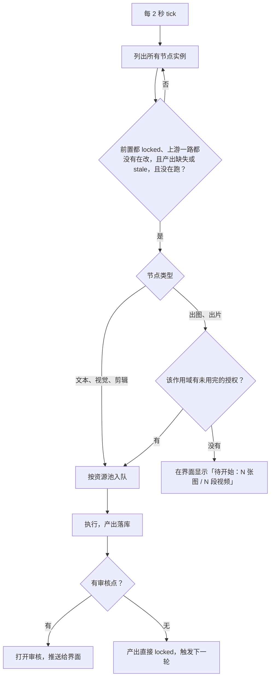
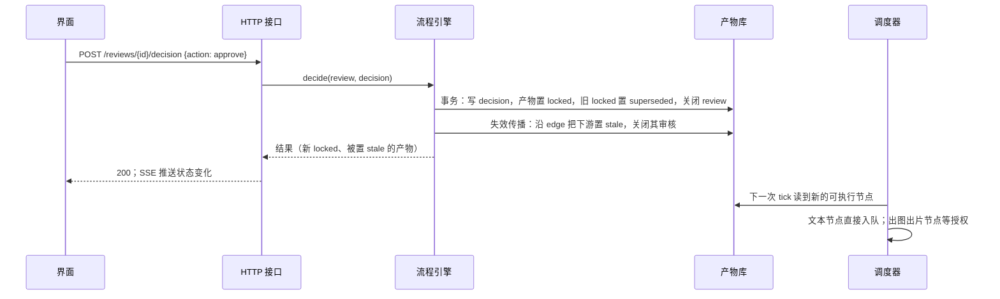
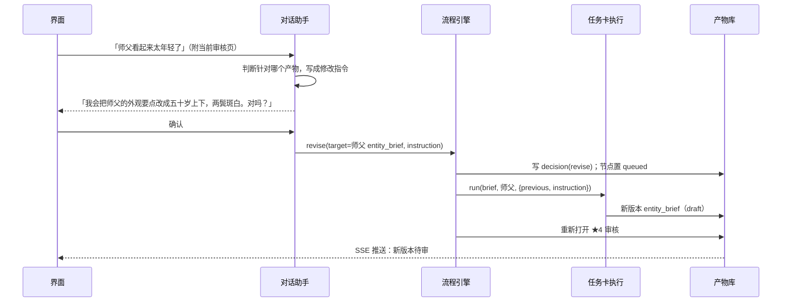
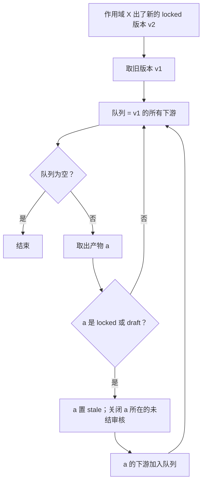

# 04 流程引擎

## 一、节点表

节点表写死在 `pipeline/nodes.ts`。每个节点声明：作用域、类型、需要哪些上游产物处于 `locked`、产出什么、有没有审核点、花不花钱。

| 节点 | 作用域 | 类型 | 前置（都须 locked） | 产出 | 审核 |
|---|---|---|---|---|---|
| `style` | 项目 | 程序 | 无 | `style_ref`（画风插件自带的风格参考图） | 无 |
| `directions` | 集 | 文本 | `style_ref` | 3 个 `direction` | ★2 选一个 |
| `script` | 集 | 文本 | 选中的 `direction` | `script`、`roster` | ★3 |
| `brief` | 集内实体；人物换上的每套造型 | 文本 | `roster`、`script`；造型另需这个人开场那套的 `entity_brief` | `entity_brief` | ★4 |
| `desc` | 集内实体；造型 | 文本 | `entity_brief` | `entity_desc` | 无 |
| `image` | 集内实体；造型 | 出图 ×2 | `entity_desc`；地点另需场内关键道具的 `entity_lock`；造型另需开场定妆照的 `entity_lock`，从它改出 | 2 个 `entity_image` | ★5 挑一张 → `entity_lock` |
| `derive` | 派生图 | 改图 | 所从出的定妆照（开场的或造型的）的 `entity_lock` | `entity_image` | ★5 |
| `audition` | 集内人物（有台词的） | 出片（试音） | 人物 `entity_lock` | `audition` | ★5 采用 → 截取为 `voice` |
| `plan` | 集 | 文本 | `script`、本集全部实体的 `entity_lock`（造型和派生图不等） | `segment_plan`；换装的那一拍必须是一段的第一拍 | 无 |
| `blocking` | 场 | 视觉（看地点主图） | `script`、`roster`、本场地点的 `entity_brief`、`entity_desc`、`entity_lock` | `blocking` | ★6 |
| `timeline` | 段 | 文本 | `segment_plan`、本段实体的 `entity_lock`、本段所在各场的 `blocking` | `timeline` | 无 |
| `view` | 地点派生视图 | 改图 | 地点 `entity_lock`、时间轴里出现的新视角 | `entity_image` | ★6 |
| `kfdesc` | 切点（承接段的第一个镜头除外） | 文本 | `timeline`、本切所需视图的 `entity_lock`、本切地点的 `entity_desc` 和 `blocking` | `keyframe_desc` | 无 |
| `keyframe` | 切点 | 出图 | `keyframe_desc`、所绑参考图 | `keyframe` | ★6 |
| `draft` | 段 | 出片 576p | 本段全部 `keyframe`、说话人 `voice`；承接段另需上一段 `clip_draft` 已采用且已裁 | `clip_draft` | ★7 |
| `trim` | 段 | 视觉模型 | `clip_draft` 已采用 | 写入 `clip_draft.trim` | 无（结果在 ★8 看） |
| `cut_draft` | 集 | 剪辑 | 全部段 `clip_draft` 已裁 | `cut_draft` | ★8 |
| `refine` | 段 | 出片 1080 | ★8 通过；承接段另需上一段 `clip_final` 已裁 | `clip_final`（按草稿的入点出点裁） | 无（结果在 ★9 看） |
| `cut_final` | 集 | 剪辑 | 全部段 `clip_final` | `cut_final` | ★9 |

说明：

- **实体从哪来**：`script` 节点通过后，引擎按 `roster` 为每个人物、地点、关键道具建立作用域，生成对应的 `brief` 节点。已在前面集锁定的实体直接复用，不再建节点。
- **锁定顺序**：画风 → 人物定妆与关键道具并行 → 地点主图 → 关键帧。人物与道具的 `image` 互不等待；地点的 `image` 要等场内关键道具（brief 点名的摆放件）锁定，`kfdesc` 要等本切的视图锁定。同一机位的每一张关键帧都用这个机位的空房间当图 1，不改上一张已经有人的关键帧。佩戴道具不挡定妆。换上的造型等开场那套的外观要点通过后再设计（脸和身形照抄），等开场定妆照锁定后从它改出（一组一个根）。
- **派生图**：人物锁定根图后自动生成三视图和脸部特写两个 `derive`，换上的造型只生成三视图（脸部特写跟开场那套）；一个名字代表几个人（`count` 大于 1）时只生成一张无人的服装平铺，关键帧和视频给他们绑平铺，不绑定妆照（经验 01-14：共用一张定妆照会让几个人长成同一张脸）。地点的额外视角在时间轴写出后才知道需要哪些，由 `view` 节点按需生成。道具设定图本身就是正面、侧面、背面三视图，场景主图和关键帧直接绑它，不另做派生。
- **站位**：每场戏在写时间轴之前先定一次站位（`blocking`）：这一场有哪些座位、站位、出入口，各在房间哪里、在主图画面的左中右哪边；每个人从哪一拍起在哪个位置、怎么走过去。写站位的模型直接看地点主图，画面左右以主图为准。一个座位同一时刻只坐一个人，由程序检查。时间轴和关键帧描述都拿它当依据。关键帧描述只拿它定人的位置，不拿地点外观要点重写房间；房间以锁定的主图或机位图为准。近景和全景只要相机朝向相同就共用这张空图，不把近景改到上一张已经有人的关键帧上（创作者 2026-10-28：那样会多手，并把桌子拉变形）。
- **按段绑造型**：一段的参考图在整段里只绑一次，所以一段穿哪套由它的第一拍决定：到这一拍为止最后换上的那套，没换过就是开场那套；`plan` 的检查保证换装不落在段中间（创作者 2026-10-28）。
- **承接**：`segment_plan` 里 `continues = true` 的段，必须等上一段草稿采用并裁好，因为要取上一段出点前的 22 帧作引导片段；精修也一样，等上一段精修片裁好，取它的尾巴。不承接的段（每个地点的第一段）可以并行排队，减少 GPU 空等。

## 二、调度

- **上游在改就等**：沿引用边往上查，任何一层上游有排队或正在跑的重写、或有比锁定版更新的草稿在等审，下游就不开始。否则用户刚提了修改意见，出图节点会拿还锁着的旧版本先画（M1 实测出过一次，白花了 4 张）。
- **花钱前要授权**：出图、出片节点只在用户点了「开始出图 / 开始出片」后才入队。授权按批：界面列出这一批要出几张图或几段视频，用户点一次，写一条 `permit`，额度用完为止。文本、视觉、剪辑节点不花生成费，自动执行。
- **资源池**：见 02。同一资源池内按集号、段号从小到大排队。
- **失败**：节点失败后状态停在 `failed`，界面显示原因和「重试」按钮；不自动重试生成任务。文本任务的校验重试在任务卡内部完成（见 05）。

## 三、审核与决定

每个审核点打开一条 `review`，列出本次要审的产物。用户的操作写成 `decision`：

| 操作 | 适用 | 引擎做什么 |
|---|---|---|
| 通过 | ★3、★4、★6、★8、★9 | 产物 `locked`，关闭审核，触发失效传播和下一步 |
| 挑一个 | ★2、★5、★7 | 被选中的 `locked`，其余 `superseded` |
| 提修改意见 | 都可以 | 经对话助手转成修改指令（见 09），对应节点带着指令重跑，生成新版本，重新打开审核。对图和视频提意见时，改的是它们所出自的文字（出图描述、关键帧描述、时间轴）；改好的文字先回到同一个审核点给用户审（显示意见、和上一版比改了哪几句、这次出图的完整提示词），通过后才等授权出图、出片（创作者 2026-10-28） |
| 重出 | ★5、★6、★7 | 不改任何上游，同一请求换种子再出一次（需要授权） |

### 时序：用户通过一项审核

### 时序：用户提修改意见

修改意见针对的产物和当前审核页不一定是同一个：在 ★5 看定妆照时说「衣服太素」，改的是这张图的出图描述。描述改好后留在 ★5 等审，审核卡上有意见、和上一版比删掉和新加的句子、这次出图的完整提示词（和出图时发出去的是同一段代码拼的）；可以通过，也可以再写意见接着改。实现上，这次重跑在 `node_run.review` 记下审核点，描述节点本身没有审核点，上游变化引起的自动重写仍直接锁定。

## 四、失效传播

- 用标准广度优先遍历，按 `edge.from_id` 建索引；记录已访问的产物，避免重复处理。
- 被置 `stale` 的产物，其节点在下一次 tick 重新变为可执行；出图出片照样等授权。
- 文本节点因上游变化而重写时，走修改模式：「上一版」是过期的那一版，「修改意见」是固定句（`config/prompts/stale.md`）加上换了新版本的上游清单，要求只改受影响的地方、其余照抄。这样改一个人物的外观，别的人物只改「区分」那一行，不会整套重来。
- 这样重写出来如果和上一版一字不差，说明上游的变化没碰到它：恢复上一版（过期时记下了原状态 `stale_from`），沿引用边把因它过期、且上游都已恢复的下游也恢复，重写的那版作废，并把它读到的新上游边转给旧版。已挑定的图因此不必重出、重审。
- 同一种实体按清单顺序设计，后面的能看到前面的（人物要区分开，道具要吻合，地点要相连）；地点要等场内道具的外观设计写完，拿它们的要点作上下文，只写摆放位置。
- 已交付的 `cut_final` 也会被标 `stale`，但文件保留，界面提示「已交付的版本基于旧素材」。

## 五、启动恢复

1. `node_run` 里状态为 `running` 的文本、视觉、剪辑节点：置回 `queued`，重新执行（这些调用可安全重复，不花生成费）。
2. 生成任务按 06、07 的恢复规则处理，处理完再开调度。
3. 未结的 `review` 原样保留。

## 六、边界情况

| 情况 | 处理 |
|---|---|
| 审核打开期间上游被改 | 审核随产物被置 `stale` 而关闭，界面提示「上游改了，这项已失效」 |
| 同一审核被两个浏览器窗口同时决定 | `decide` 在事务里检查 review 仍是 `open`，后到的返回 409 |
| 产物的前置被置 `stale` 时节点正在跑 | 节点照常跑完，产出落库后立即按 `input_digest` 判定为 `stale` |
| 用户删除一个审核中的实体 | 第一版不支持删除实体；要去掉某个人物，改剧本 |
| 一集时长超出 96–144 秒 | `plan` 节点的检查报错，提示把末尾内容挪到下一集或改剧本 |
