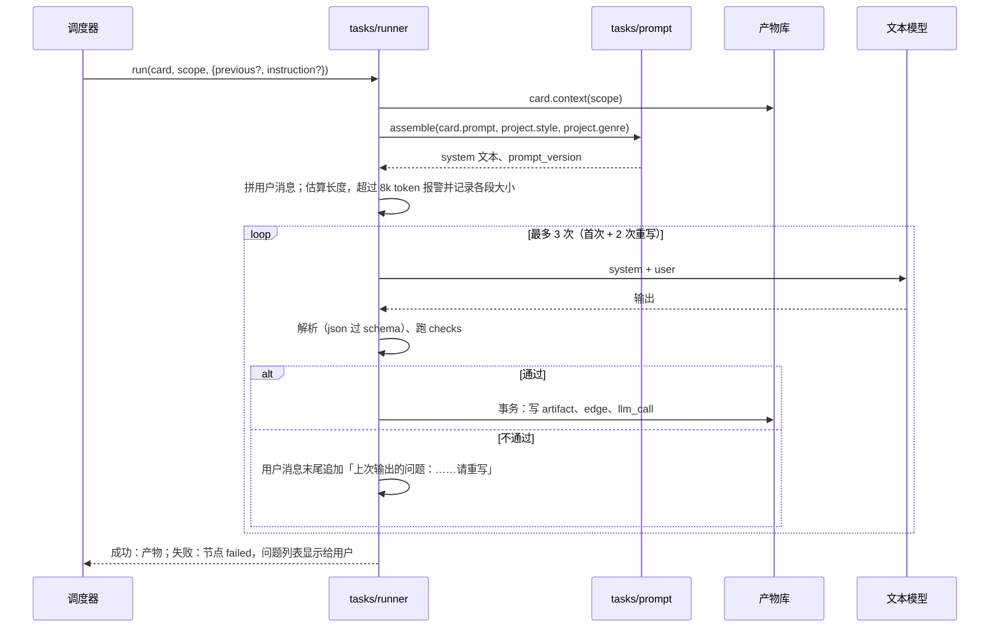

# 05 任务卡与提示词

## 一、任务卡

每类文本模型调用是一张任务卡，放在 `src/tasks/<任务>.ts`：

```ts
interface TaskCard<Out> {
  name: string                          // 「定妆描述」
  prompt: string                        // config/prompts/tasks/portrait-desc.md
  context(db: Store, scope: Scope): Context        // 按清单取上游产物
  output: 'json' | 'text'
  schema?: ZodType<Out>                 // json 输出的结构
  checks(out: Out, ctx: Context): Problem[]        // 程序能确定的检查
  save(db: Store, scope: Scope, out: Out, ctx: Context): Artifact
}

interface Context {
  inputs: ArtifactRef[]                 // 读到的上游产物（具体版本），用于 edge 和 input_digest
  sections: { title: string; body: string }[]      // 拼成用户消息的各段
}
```

### 一次调用的过程



- 重写次数 2 是拍的，M0 看失败率再定。
- 8k token 的报警线是拍的（定妆照实验每次读入约 5.3k），只算我们发出的系统提示词和用户消息；模型网关自己附加的部分不算（七牛实测：只发一句话时计费输入约 4.2k token）。
- 每次调用都记 `llm_call`：完整的 system、user、输出、token、耗时，用于复查和盲审。
- **修改模式**：带 `previous` 和 `instruction` 时，用户消息末尾加两段：「上一版」（上一版输出原文）和「创作者的修改意见」。系统提示词不变。

### 用户消息格式

按上下文清单的顺序，每段一个中文标题：

```text
【人物卡】
沈照雪：女，看起来二十四岁，青冥宗宗主，女主；本集要手持宗主令、被押上石台；冷而倔。

【剧本里写到她外貌的原句】
……

【同集其他人物】
厉寒山：主色玄黑，宽肩，束发冠……
```

清单里没有的东西不放。清单为空的段不出现。

## 二、各任务的上下文与输出

| 任务 | 提示词文件 | 插件片段 | 上下文 | 输出 | 程序检查 |
|---|---|---|---|---|---|
| 故事方向 | `story-directions.md` | genre.name | 一句话、单集时长 | json：3 个方向 | 恰好 3 个；字段齐全 |
| 剧本 | `script.md` | genre.name | 选中的方向；小说入口加覆盖的章节原文 | json：`script`、`roster` | 每拍有预计秒数；总秒数在 96–144；台词说话人都在 roster 里 |
| 人物外观设计 | `character-design.md` | style.name、genre.name、genre:character | 人物卡这一行；剧本里写到他外貌的原句；持有人写到他的道具名和持有方式（只写戴在哪，样子归道具设计）；同集其他人物主色和轮廓 | 文本：每行「部位：要点」 | 每行有部位和要点；有「区分：」行；必写部位都出现 |
| 地点外观设计 | `location-design.md` | style.name、genre.name | 地点名、发生在这里的拍、场内关键道具名和持有方式；已设计的地点要点（地点按顺序设计，相连的部分照前面的写） | 文本：每行「部位：要点」 | 同上 |
| 道具外观设计 | `prop-design.md` | style.name、genre.name、genre:prop | 道具名、用到它的拍、持有人 | 文本 | 同上 |
| 定妆描述 | `portrait-desc.md` | style.name、genre.name、style:writer | 外观要点 | 文本：一段 | 长度在范围内；越界词检查（见四） |
| 场景主图描述 | `location-desc.md` | style:writer、genre:describe | 外观要点 | 文本 | 同上 |
| 道具设定图描述 | `prop-desc.md` | style:writer、genre:describe | 外观要点 | 文本 | 同上 |
| 换机位描述 | `location-view-desc.md` | genre:describe | 地点外观要点、需要的视角（来自时间轴） | 文本 | 越界词检查 |
| 分段 | `segment-plan.md` | 无 | 剧本、已锁定实体名单（名字） | json：`segments` | 每段 4–15 秒整数；所有拍都被覆盖；一句台词不跨段；总长在范围内 |
| 段时间轴 | `timeline.md` | 无 | 这一段的拍；前后段各一句；承接段另给上一段最后一个镜头（运镜、镜头、最后一秒），所以一串承接段按顺序写；出场实体名单；此刻状态 | json：`timeline` | 总秒数等于段长；切点在段内；台词逐字等于剧本；每秒都有内容 |
| 关键帧描述 | `keyframe-desc.md` | genre:describe | 时间轴里这一秒；出场实体与参考图编号；主色和陈设数量；此刻状态 | 文本 | 越界词检查；参考图编号都在对应表里 |
| 裁头尾 | `trim.md` | 无 | 片段抽帧、段时长、是否承接 | json：`in`、`out` | 见 08 |
| 对话助手 | `assistant.md` | 无 | 见 09 | json | 见 09 |

提示词文件都在 `config/prompts/tasks/` 下。

「此刻状态」由程序从剧本推出：每一拍写了哪些东西变了（受伤、出鞘、锁链断），段时间轴和关键帧描述拿到的是到这一刻为止的累计状态。

## 三、提示词文件与组装

所有提示词用中文写：系统提示词、用户消息，以及交给 GPT Image 和 H3 的提示词。系统提示词统一三段：「你是什么」「你要干什么」「输出是什么」。

### 提示词是代码配置

系统提示词和固定句都是代码仓库里的配置文件，随代码一起做版本管理；改提示词就是改配置文件。文件里只有发给模型的正文，没有注释和出处。

```text
config/
  prompts/
    tasks/<任务>.md                每个任务一份系统提示词，通用
    image-types/<图类>.md          每类图的固定部分：背景、构图、光
  plugins/
    style/<画风>/                  画风插件
      plugin.json
      writer.md                    插进写手提示词的画风要求
      image/<对象>.md              插进出图提示词开头的画风句：人物、道具、场景、关键帧各一句，plugin.json 的 imagePrefix 写每类图用哪一句
      style-ref.png                风格参考图：没有人、没有字的场景，绑给场景主图、换机位图和关键帧
    genre/<题材>/                  题材插件
      plugin.json
      character.md、prop.md、describe.md
```

图类：`portrait`（定妆照）、`turnaround`（三视图）、`face`（脸部特写）、`prop-sheet`（道具设定图）、`location`（场景主图）、`location-view`（换机位图）、`keyframe`（关键帧）。定妆照、三视图、脸部特写用人物句，道具设定图用道具句，场景主图、换机位图用场景句，关键帧用关键帧句。

### 组装

任务提示词里用占位符引用插件片段：

| 占位符 | 换成 |
|---|---|
| `{{style.name}}`、`{{genre.name}}` | 画风、题材插件 `plugin.json` 里的 `name` |
| `{{style:writer}}`、`{{style:character}}` | 画风插件 `fragments` 里对应文件全文 |
| `{{genre:character}}`、`{{genre:prop}}`、`{{genre:describe}}` | 题材插件 `fragments` 里对应文件全文 |

规则：

1. 组装后文本里还剩 `{{` 就报错，不发请求。
2. 引用的片段在插件里没有声明、或声明的文件不存在，就报错。题材插件某个片段确实没有要求时，放一个空文件，以区分「忘了写」。
3. `prompt_version` = 组装后系统提示词全文的 sha256 前 16 位，随每次调用和产物记录。

### 插件

画风和题材以插件提供，为以后扩展留空间。第一版只内置一个画风插件 `3d-guoman`（3D 国漫）和一个题材插件 `xianxia`（仙侠），立项时直接使用，不提供选择。

- `plugins.ts` 启动时扫描 `config/plugins/`，读每个 `plugin.json`：声明了的文件只要有一个不存在，整个插件就不加载，并写明缺了什么。
- 插件可以暂时不声明某项能力（例如还没做风格参考图）；用到这项能力时（出图要画风句和风格参考图）再检查，没有就报错。这样文本任务能先跑起来，出图的部分在 M1 补齐。
- 画风插件的片段：`writer`（所有描写任务都用的画风要求）、`character`（只有人物相关任务用：美型档次、肤质）。题材插件的片段：`character`、`prop`、`describe`。
- 项目表里记 `style`、`genre` 两个插件 id。
- 以后加一个画风或题材，就是新增一个插件目录；立项页在有多个插件时再加选择。

## 四、出图提示词的拼装

模型只写主体段，其余由程序按固定顺序拼：

```text
1. 画风句        画风插件 image/<图类>.md
2. 参考图说明    程序生成：「参考图 1 是沈照雪的定妆照，参考图 2 是石殿主图……」
3. 主体段        模型写的描述（定妆描述、场景描述、关键帧描述等）
4. 固定部分      config/prompts/image-types/<图类>.md：背景、构图、光
```

各图类的组成：

| 图类 | 画风句 | 参考图 | 主体段 | 固定部分 |
|---|---|---|---|---|
| 定妆照 | 有 | 无 | 定妆描述 | 浅灰纯色背景、柔和均匀光、全身、中性站姿、颈部挺直 |
| 三视图 | 有 | 定妆照 | 无，「同一个人、同一套衣服，正面、侧面、背面」写在固定部分里 | 三个全身等高、正交、浅灰底、无文字 |
| 脸部特写 | 有 | 定妆照 | 无，「同一张脸，正面头肩」写在固定部分里 | 浅灰底、柔和光 |
| 道具设定图 | 有 | 无 | 道具描述 | 浅灰底、正面平光、无投影、正交、一处细节放大 |
| 场景主图 | 有 | 风格参考图；场内关键道具三视图 | 场景描述 | 不画人、开场状态、框入整个场景 |
| 换机位图 | 有 | 地点主图；风格参考图 | 换机位描述 | 不画人 |
| 关键帧 | 有 | 人物定妆照、地点视图、关键道具三视图、风格参考图 | 关键帧描述 | 无（`keyframe.md` 是空文件，表示确实没有） |

拼装在 `src/compose.ts` 的 `imagePrompt`：四部分之间空一行，空的部分跳过；参考图说明写成「图 1 是……。图 2 是……。」，和关键帧描述里的编号一致。

**越界词检查**：模型写的主体段里出现画风、背景、构图、机位、光照这几类词（词表在 `compose/boundary.ts`），就让模型重写这一段，计入任务卡的重写次数。关键帧描述允许写人物受光方向，词表按图类区分。

**参考图数量**：GPT Image 的上限按 Yir 接口返回的合同读取，超出时按「起始帧、主要动作人物、关键道具、地点、其余人物」的顺序保留。

## 五、视频提示词的编译

视频提示词完全由程序编译，不经模型。H3 官方格式分六段，按顺序：

| 段 | 内容来源 |
|---|---|
| 主体定义 | 每张参考图的编号和指代：「<Picture 1> 是沈照雪，穿白袍」（含区分词）；「<Audio 1> 是沈照雪的声音」 |
| 概要 | 分段计划里这一段的一句话 |
| 保持 | 固定句：参考图里的人物、服装、道具、场景保持不变 |
| 详细描述 | 时间轴逐秒正文，切点处标「第 N 切」 |
| 声音 | 台词时间线（谁、首字到末字、说什么、说完闭嘴）和底声 |
| 配乐 | 固定为「无」 |

六段的中文名称和写法以 H3 官方文档为准，M1 前对一遍；M1 同时测中文与英文的效果。

## 六、提示词怎么写

1. 统一三段：你是什么 → 你要干什么 → 输出是什么。
2. 「你要干什么」按模型写作的顺序组织：写什么、为什么要写全 → 按画面从整体到局部列出要写详细的地方 → 写法 → 不写什么。
3. 一个任务只放它用得到的要求；只适用于某个画风或题材的，写进对应插件的片段，任务提示词里只放通用的。
4. 同一个要求全篇只说一次；保留短例子（「过道两侧各三条」「无刘海」）帮模型把握程度。
5. 每份约 1500 字以内（拍的，M0 后校正）。

旧项目和 manju 中有用的经验已经写进这些提示词和流程设计；审核过程稿在 `docs/归档/经验审核/`，只作历史记录。
