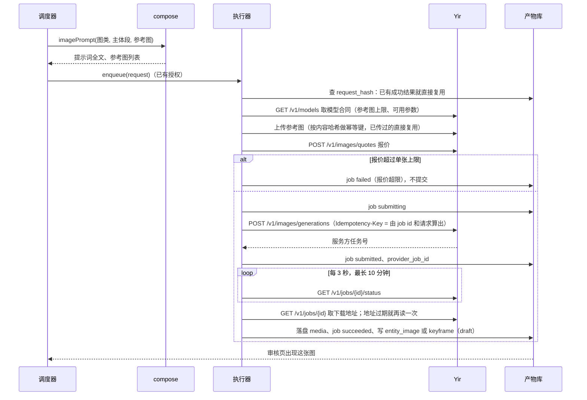

# 06 出图（GPT Image，经 Yir）

## 一、出哪些图

| 图 | 何时出 | 张数 | 参考图 | 审核 |
|---|---|---|---|---|
| 定妆照（人物根图） | 定妆描述写好、授权后 | 2 张候选 | 无 | ★5 挑一张 |
| 三视图、脸部特写 | 根图锁定后自动排队，等授权 | 各 1 张 | 根图 | ★5 通过或重出 |
| 造型定妆照 | 出场清单写了换装；这套的定妆描述写好、开场定妆照锁定、授权后 | 2 张候选 | 开场定妆照 | ★5 挑一张；之后同样派生三视图（不出脸部特写） |
| 服装平铺 | 一个名字代表几个人（`count` 大于 1）：定妆照锁定后代替三视图和脸部特写 | 1 张 | 定妆照 | ★5 通过或重出 |
| 道具设定图 | 描述写好、授权后 | 2 张候选 | 无 | ★5 挑一张 |
| 场景主图 | 场内关键道具锁定、描述写好、授权后 | 2 张候选 | 风格参考图、关键道具的设定图 | ★5 挑一张 |
| 换机位图 | 时间轴写出需要的视角后 | 1 张 | 地点主图、风格参考图 | ★6 通过或重出 |
| 关键帧 | 关键帧描述写好、授权后 | 1 张 | 图 1：这个机位的空房间；其后人物、关键道具、风格参考图 | ★6 通过或重出 |

候选数 2 是拍的。

**一组图一个根**：人物的根是全身正面定妆照，三视图、脸部特写、造型变体都以根图为底图改出来，图与图之间不互相参考。凡跨镜头出现的人物（含龙套）都单独出定妆照。

**锁定之后**：下游只绑锁定图，不再把画图之前的外观文字交给换机位和关键帧重写房间（创作者 2026-10-28）。换机位描述只写相机站在哪里。关键帧描述只写人和动作，图 1 是这个机位的空房间。近景也用这张空图，不改上一张关键帧。多人同框时人名后加主色（「穿白袍的某某」）。M1 验证只绑图时细节（发饰、挂件、纹样）保不保得住，保不住的记下模型和细节类别，交用户决定加特写参考图还是在提示词里点一句。

## 二、一张图的完整过程

## 三、关键约定

1. **单张费用上限**：每张图提交前先报价，超过上限不提交。上限默认 0.10 美元（沿用 manju，medium 1K 实测约 0.0067–0.0085 美元一张）。
2. **只发合同里声明的参数**：Yir 的模型合同里没有的参数不发，取值不在合同列表里的也不发。
3. **幂等**：提交请求带 Idempotency-Key，由 job id 和请求内容计算。进程在提交途中崩溃，重启后用同一个键重提，Yir 返回同一个任务，不会重复扣费。所以 GPT Image 的 `submitting` 任务在恢复时可以直接重提；同一张图要重出时换新 job id，得到新的键。
4. **改图**：三视图、脸部特写、换机位图用编辑模式，把根图或主图作为参考图传入。提示词里写明只改哪处，其余保持。
5. **重出**：用户在审核页点「重出」，同一提示词、同一参考图，新 job id，需要授权。

## 四、失败处理

| 情况 | job 状态 | 界面 |
|---|---|---|
| 报价超限 | failed（不提交） | 「这张图报价 X 美元，超过上限，没有出」 |
| 参考图超过合同上限 | 不入队 | compose 阶段已按顺序截断；截断时界面列出没绑上的图 |
| 上传失败、文件迟迟未就绪 | failed | 显示原因，可重试。参考图的幂等键按文件内容计算；Yir 会把一次 503 记在这把键上并一直回放（2026-10-28，风格参考图）。这把键返回可重试的错误时，换一把新键再传一次。同一进程里已经传成的文件号留着复用 |
| 服务方报失败 | failed | 显示服务方错误码 |
| 被内容审核拦截 | failed，标「被拦截」 | 提示改描述或改外观要点，不自动重出 |
| 下载地址过期 | 重读一次任务取新地址；仍失败重试 3 次后 failed | |
| 轮询超时 | failed | 可重试（同一 job id，用原幂等键先查是否已完成） |

## 五、启动恢复

| 恢复前状态 | 处理 |
|---|---|
| `queued` | 不变 |
| `submitting` | 用原幂等键重提：Yir 返回原任务号就继续轮询；返回新任务号说明上次没收到，也照常继续 |
| `submitted` | 继续轮询 |
| `downloading` | 重新下载 |
