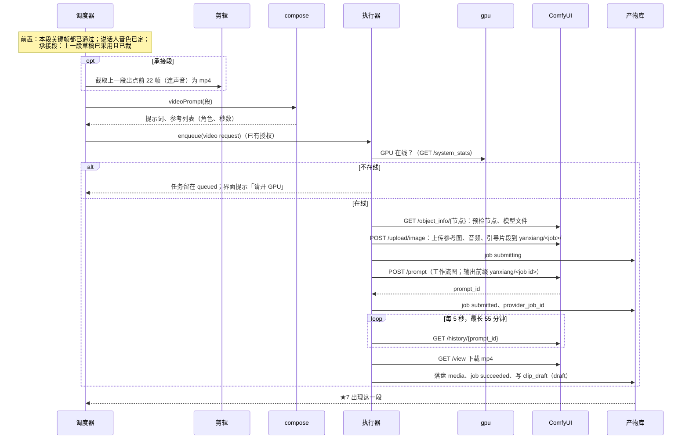

# 07 视频（H3，自部署 ComfyUI）

## 一、一段视频的组成

| 项 | 内容 |
|---|---|
| 时长 | 4–15 秒整数，帧数按 24 帧/秒、17k+5 取整（15 秒为 362 帧） |
| 参考图 | 本段每个切点的关键帧（既当参考图又钉在切点秒数上；承接段的第一个镜头由引导片段接上，不出关键帧）；出场人物定妆照；地点视图；关键道具的设定图。合计最多 9 张 |
| 参考音频 | 本段说话人的音色，最多 3 段 |
| 引导片段 | 承接段：上一段出点前的 22 帧连声音，钉在第 0 帧，只钉不当参考 |
| 提示词 | 程序编译（见 05），参考图写作 `<Picture n>`，音频写作 `<Audio n>` |
| 模式 | Ref2VA（参考生视频）；不用首尾帧模式 |

**参考图超过 9 张时**：先保关键帧（切点钉帧必需），再按主要动作人物、关键道具、地点、其余人物的顺序保留。关键帧本身已经画了人和场景，丢掉的参考图影响的是切点之间的画面；界面列出这一段没绑上的参考图。

## 二、草稿与精修

| | 草稿 | 精修 |
|---|---|---|
| 预设 | 576p，lightx2v 8 步加速 LoRA 满强度，稀疏注意力开 | 同一张工作流：第一遍和草稿完全相同，再把潜空间放大 1.875 倍到 1920×1088，按 0.45、0.3、0.15、0 重做最后几步，放大后再钉一次关键帧 |
| 种子 | 由 job id 算出，记进 `clip_draft.seed` | 用草稿的种子 |
| 参考图、音频 | 见上 | 与草稿相同 |
| 引导片段 | 上一段草稿出点前 22 帧 | 上一段**精修片**出点前 22 帧（出点沿用草稿的裁剪） |
| 打戏 | 加挂 wushu 动作 LoRA，强度 0.7 | 同草稿 |
| 耗时（5090，n=2） | 八步约 165–184 秒 | 约 396 秒 |

精修的引导片段用上一段精修片的尾巴，这样成片里每个接缝两边都是精修画面。代价有两个：

- **精修要按顺序做。** 承接段要等上一段精修并裁好才能开始；不承接的段（每个地点的第一段）不受影响。
- **精修和草稿的表演可能不完全一样。** 精修第一遍的引导片段和草稿不同，输入变了，动作可能和你采用的草稿有出入。不专门比对，由你在 ★9 看整集时指出走样的段，只重精修那一段和接在它后面的段。

## 三、出一段草稿

用户在 ★7 采用后：裁头尾（见 08）→ 下一段（承接段）的前置满足 → 等授权后出下一段。不承接的段可以和别的段并行排队，但同一台 GPU 一次只跑一个工作流。

精修同理：★8 通过后，每个地点的第一段先精修；精修完按草稿的入点出点裁好，截出点前 22 帧，下一段再带着这条尾巴精修。

## 四、试音

有台词的人物，在定妆照锁定后出一条试音片段：4–6 秒（拍的），绑定妆照，写一句符合人物的独白，不带参考音频，让 H3 自己出声。用户在 ★5 听，选中的那条截取人声 2–15 秒存为 `voice`，之后这个人物所有段都绑这段音频。不满意就重出。

## 五、GPU

1. 用户手动开关机。程序只检查：SSH 隧道是否通（`127.0.0.1:8188`）、`/system_stats` 是否响应、预检节点和模型文件是否都在。
2. 只接受本机回环地址，防止把请求发到别处。
3. 界面顶部常驻 GPU 状态：离线、在线空闲、在跑第几段、队列里还有几段。
4. 有授权的视频任务在 GPU 离线时停在 `queued`，上线后自动开始。

## 六、启动恢复

ComfyUI 没有幂等键，靠输出前缀找回：

| 恢复前状态 | 处理 |
|---|---|
| `submitting`（没有 prompt_id） | 读 `/history` 和 `/queue`，找输出前缀为 `yanxiang/<job id>` 的任务：找到就补上 prompt_id 继续；找不到标 `unknown`，界面问用户「这段可能没提交成功，要重提吗」，不自动重提 |
| `submitted` | 继续轮询；`/history` 和 `/queue` 里都没有这个 prompt_id（GPU 重启过）就标 `unknown` |
| `downloading` | 重新下载 |

## 七、失败处理

| 情况 | 处理 |
|---|---|
| 预检缺节点或模型文件 | job 不提交，failed，界面写缺什么 |
| 工作流被 ComfyUI 拒绝（400） | failed，记录返回信息 |
| 执行报错 | failed，记录 ComfyUI 的错误消息 |
| 轮询超时 | failed |
| 完成但没有 mp4 | failed |
| 下载失败 | 重试 3 次后 failed |

都不自动重出。生成结果不好由用户在 ★7 说，或点「重出」（换种子，需要授权）。
