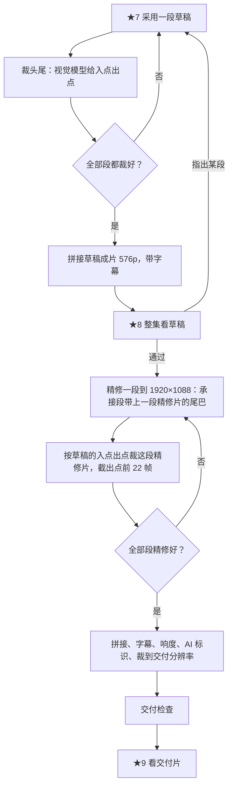
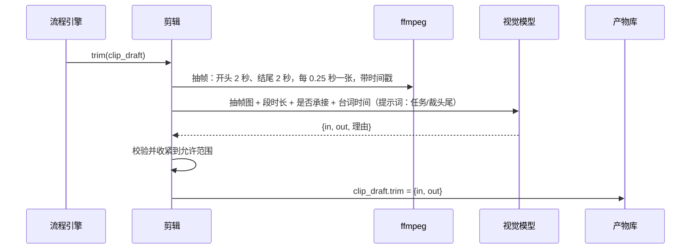

# 08 剪辑与交付

用户不剪辑。剪辑模块按段顺序自动完成：裁头尾、拼接、字幕、响度、标识、交付检查。

## 一、总流程

## 二、裁头尾

H3 生成的段开头常有 0.3–0.8 秒发呆或形变，结尾动作做完后空转（旧项目观察）。用户采用一段后：

允许范围（数字是拍的，M1 看片后定）：

- 承接段的入点至少是重放长度（22 帧，约 0.92 秒），重放部分必须剪掉。
- 除重放外，开头最多再裁 1 秒，结尾最多裁 1.5 秒。
- 入点出点不能切掉任何一句台词：出点不早于最后一句台词结束后 0.2 秒。
- 模型输出越界时按上面的范围收紧，并在 ★8 标出「这段的裁剪被程序调整过」。

视觉模型只决定裁哪里，不决定这一段用不用。精修片用同样的入点出点。

**截取承接尾巴**：下一段的引导片段取自这一段出点之前的 22 帧（连声音），因此必须在裁完之后截取。草稿阶段取草稿的尾巴，精修阶段取精修片的尾巴。

## 三、拼接

1. 每段按 `trim` 截取：`ffmpeg -ss <in> -to <out> -i clip.mp4`，重新编码为同一规格（h264、24 帧/秒、AAC 48 kHz）。
2. 按段顺序用 concat 滤镜拼接视频和音频。段与段之间直接切，不加转场；转场、闪白这类手法已经在段内由 H3 生成。
3. 草稿成片保持 576p；交付片先裁到交付分辨率：
   - 1080p：`crop=1920:1080:0:4`，不缩放。
   - 720p：先 `crop=1920:1080:0:4`，再 `scale=1280:720`。

## 四、字幕

1. 文字逐字照录剧本台词，去句末标点，保留问号、叹号。
2. 时间：先用时间轴里的台词起止时间，减去本段入点，加上本段在成片里的起点。
3. 计划时间和 H3 实际说话时间可能有偏差，所以用本机语音识别校时间：只用识别结果的时间戳，不用识别出的文字。识别用 whisper.cpp（命令行，不引入 Python）；识别不到某句时退回计划时间，并在 ★8 标出。
4. 用 ASS 字幕烧进画面，底部留出约十分之一画面高度的安全区。

## 五、响度与标识

1. 两遍 loudnorm：第一遍测量，第二遍按 `I=-15:TP=-1:LRA=11` 归一。
2. 开头 0–2 秒右上角叠加「AI生成」，字高不低于画面短边的 5%。
3. 写入 AIGC 元数据（文件 metadata 的 comment 字段）。

## 六、交付检查

用 ffprobe 和 ffmpeg 的检测滤镜，任一不过就在 ★9 标红，不阻止用户交付：

| 检查 | 标准 |
|---|---|
| 分辨率 | 等于项目设定的交付分辨率 |
| 帧率、编码 | 24 帧/秒，h264，AAC |
| 总时长 | 96–144 秒 |
| 黑场 | `blackdetect` 没有超过 0.5 秒的黑场（拍的） |
| 静音 | `silencedetect` 没有超过 3 秒的静音（拍的） |
| 响度 | 实测积分响度在 -15 ± 1 LKFS |
| 字幕 | 每句台词都有字幕，字幕文字与剧本逐字一致 |

## 七、交付物

`data/<项目>/交付/第N集/`：成片 mp4、字幕文件、本集剧本、交付检查结果。
