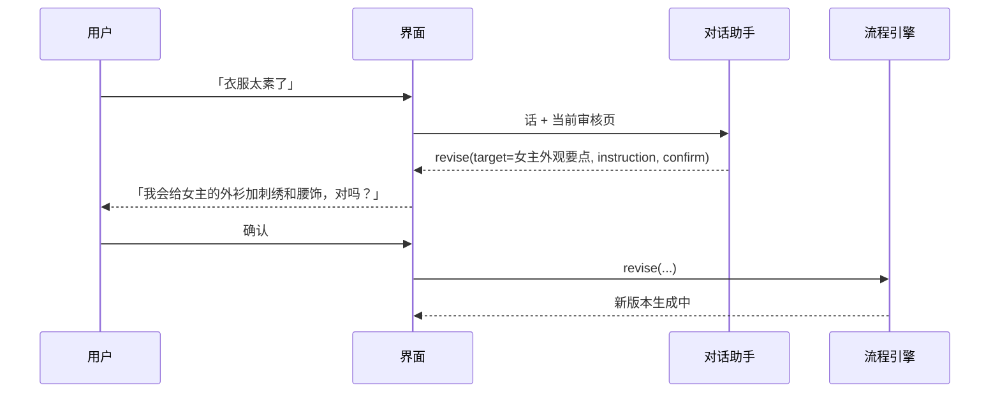

# 09 对话助手与界面

## 一、对话助手

### 职责

把用户的自然语言变成引擎能执行的操作。它是一次不带工具的模型调用，输出固定格式的 JSON，由引擎执行。它不能出图、入队、跳过审核点，也不能改提示词。

### 输入

| 段 | 内容 |
|---|---|
| 当前页面 | 用户所在的审核点、页面上的产物（编号、类型、摘要） |
| 产物摘要 | 页面上每个产物的文字内容；图和视频只给文字说明（它的描述或时间轴），不给图 |
| 最近对话 | 最近 10 轮（拍的） |
| 用户这句话 | 原文 |

### 输出

```ts
type AssistantAction =
  | { kind: 'revise'; target: ArtifactId; instruction: string; confirm: string }
  | { kind: 'redo'; target: ArtifactId; confirm: string }        // 不改上游，换种子重出
  | { kind: 'approve'; target: ArtifactId }
  | { kind: 'ask'; question: string }                            // 意思不清时反问
  | { kind: 'explain'; text: string }                            // 回答「为什么」「现在到哪了」
```

- `confirm` 是给用户确认的一句话，例如「我会把师父的外观要点改成五十岁上下、两鬓斑白，对吗？」。用户确认后引擎才执行。
- `target` 必须是当前页面上的产物，或者它的上游（例如在 ★5 改外观要点）。不在范围内的，引擎拒绝并让助手反问。

### 时序



意见只作用于当前项目里的这个产物，不改提示词配置。

## 二、界面

### 页面

| 页面 | 内容 |
|---|---|
| 项目列表 | 所有项目、每个项目卡在哪个审核点 |
| 立项 | 输入一句话或导入小说；选交付分辨率 |
| 审核台 | 所有打开的审核按顺序排队，点进去就是对应的审核页 |
| 审核页 ★2–★9 | 每个审核点一个页面，左侧是要审的产物，右侧是对话 |
| 进度 | 节点运行情况、生成任务、GPU 状态、失败原因和「重试」 |
| 设置 | 模型服务（地址、接口类型、密钥存钥匙串）、默认文本模型和视觉模型、按任务单独配模型、测试连接；GPU 地址；并发上限 |

### 审核页的共同布局

```text
┌──────────────────────────────────┬──────────────────┐
│ 标题：★5 定妆与场景  第 1 集       │ 对话              │
│ ┌──────┐ ┌──────┐                 │                  │
│ │候选 1│ │候选 2│   沈照雪          │ 助手：……          │
│ └──────┘ └──────┘   外观要点（收起）│                  │
│ [选这张] [都不行，说哪里不对]       │                  │
│ ……下一个实体……                    │                  │
│ 底部：待开始：4 张图  [开始出图]    │ [输入框]          │
└──────────────────────────────────┴──────────────────┘
```

- 提示词默认收起，点开能看到本次用的完整提示词和参考图。
- 「开始出图 / 开始出片」按钮显示这一批的数量，点击即授权（见 04）。
- 视频页（★7、★8、★9）带逐秒时间轴，用户指出「第几秒」时自动带上时间点。

### HTTP 接口

| 方法 | 路径 | 作用 |
|---|---|---|
| GET | `/api/projects` | 项目列表 |
| POST | `/api/projects` | 立项 |
| GET | `/api/projects/:id/status` | 节点、审核、任务、GPU 状态 |
| GET | `/api/reviews?project=` | 打开的审核 |
| GET | `/api/reviews/:id` | 审核页数据（产物、图、片、提示词） |
| POST | `/api/reviews/:id/decision` | 通过、挑选、重出 |
| POST | `/api/permits` | 授权一批出图或出片 |
| POST | `/api/assistant` | 发一句话，返回助手的操作和确认语 |
| POST | `/api/assistant/confirm` | 确认执行助手提出的操作 |
| POST | `/api/node-runs/:id/retry` | 重试失败的节点 |
| POST | `/api/jobs/:id/resolve` | 处理 `unknown` 的任务：重提或放弃 |
| GET | `/api/media/:id` | 图片、视频文件 |
| GET | `/api/events?project=` | SSE：审核打开、产物状态变化、任务进度、GPU 状态 |
