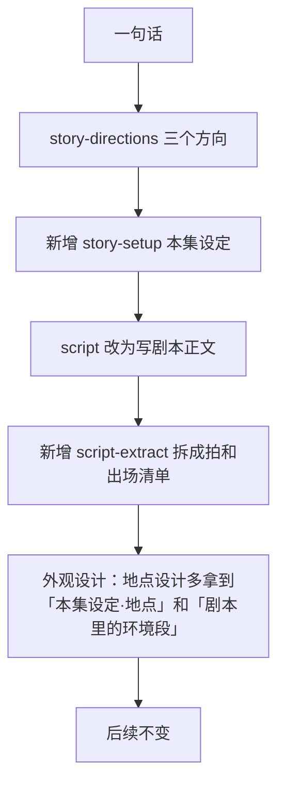

# AI 漫剧开源方案对比与改进建议

日期：2026-10-27。我们现行的全部提示词见 [现有提示词汇编](现有提示词汇编.md)。

## 结论

1. **剧本像过家家，根子不在模型，在提示词只管格式不管戏。** `script.md` 全文 957 字，讲的都是「拍怎么切、JSON 怎么填」，没有一句讲冲突、对手、台词、代价和仙侠题材；仙侠插件也没有任何讲故事的片段。经验审核时「剧本整节」被删掉了（[提炼版](../归档/经验审核/提炼版.md) 第十节），同批删掉的「通用剧作常识」写的理由是「模型本来就会，写进提示词只占上下文」（[一句话/05](../归档/经验审核/一句话/05-故事与剧本.md) 05-38）。M0 的产出说明这个假设不成立。调研的几家口碑好的方案，没有一家只靠格式合同写剧本。
2. **场景不像仙侠，是因为上游没给、下游不许。** 剧本 JSON 里根本没有环境描写的位置，地点设计只拿到「地点名 + 剧情动作」，提示词又要求按动作需要设计陈设；仙侠插件的 `describe` 片段只有一句「古代刻字不加标点」。同时「不写氛围、不写比喻、不擅自加雾」这几条把模型往极简里推。于是「锁魂洞」被写成了纵深六个人、深灰岩地、带排水沟的矿洞。
3. **我们的一致性工程（数量写死、画面左右、状态累计、锁图、越界词检查）比多数开源项目做得细，这部分不要动。** 缺的是一层「戏」和一层「题材」：剧本前补一步本集设定，剧本先写正文再拆结构，题材插件补上故事、台词、地点三个片段。

## 一、看了哪些项目

星数和最近推送时间是 2026-10-27 从 GitHub API 读的。提示词原文都来自浅克隆后打开的源码，路径相对各仓库根目录。

| 项目 | 星数 | 最近推送 | 是什么 | 对我们最有用的 |
|---|---|---|---|---|
| [Toonflow](https://github.com/HBAI-Ltd/Toonflow-app) | 19.6k | 10-27 | 无限画布短剧/漫剧工作台，Agent + 技能包 | 编剧方法、12 类叙事（含古风仙侠）、场景设计分层 |
| [火宝短剧 huobao-drama](https://github.com/chatfire-AI/huobao-drama) | 16.7k | 10-25 | 一句话或小说到成片的流水线 | 剧本场头、场景空镜模板、道具三问 |
| [waoowaoo](https://github.com/waooAI/waoowaoo) | 14.7k | 09-21 | 自托管影视生产 Agent | 剧本「正确但无聊不合格」、写前构思、写后自评 |
| [ViMax](https://github.com/HKUDS/ViMax) | 12.8k | 09-30 | 港大的 Agent 视频框架 | 先写故事正文再拆场；带范例的分类型编剧提示词（未接入主流程） |
| [zenstory drama-skills](https://github.com/zenstory-ai/drama-skills) | 3.4k | 10-20 | 短剧/漫剧 Claude/Codex 技能合集（旧项目 tianyanzhizhu 用的就是它的 fork） | 故事引擎、仙侠题材卡、对白手艺、Location/View |
| [oh-story-claudecode](https://github.com/zenstory-ai/oh-story-claudecode) | 8.0k | 10-26 | 中文网文全流程技能 | 东方仙侠正文卡、去 AI 腔句式 |
| [screenwriting-skills](https://github.com/jtydhr88/screenwriting-skills) | 1.8k | 10-03 | 编剧书收成的 26 个技能 | 反直白台词、对手要强、不许请祥云 |
| [xianxia-visual-director](https://github.com/liyue-aigc/xianxia-visual-director) | 585 | 08-08 | 仙侠场景静帧提示词技能 | 用人体核对尺度、五层空间、云海位置 |

另外参考了旧项目 `tianyanzhizhu/.cursor/skills/short-drama-storyboard/references/业界做法/3D国漫风/仙侠/老李玄幻漫剧/` 的仙侠场景和特效词库。没展开的：moyin-creator、Jellyfish（偏已有剧本的拆镜）、NarratoAI（解说剪辑），官方 anthropics/skills 里没有剧本类技能。

## 二、它们怎么写剧本

### 共同点：没有一家只用格式合同

| 做法 | 谁这么做 | 我们 |
|---|---|---|
| 剧本前有中间产物：故事核、人物小传、信息差表、真相 | Toonflow（`scriptCraft.md`：故事核 → 人物小传 → 三幕 → 分集大纲 → 信息差与反转登记）；drama-skills（`creative-brief.md`、`story-engine.md`） | 无。方向提示词还明写「不写世界观设定」 |
| 剧本先写成正文，结构另外拆 | 火宝（`## S01 \| 内景 · 咖啡厅 \| 黄昏` + 环境段 + 对白）；ViMax（`agents/screenwriter.py` 先写故事正文，再按场写剧本）；waoowaoo（`screenplayText` 存整篇正文）；Toonflow（场头 + `△` 动作） | 直接输出拍的 JSON，带秒数和状态变化 |
| 写作手艺写进提示词 | 全部 | 无 |
| 题材专章 | Toonflow（12 类，含古风仙侠）；drama-skills（仙侠修真卡）；oh-story（东方仙侠卡） | 仙侠插件只有人物、道具、刻字三个片段，没有故事 |
| 范例 | ViMax（`script_planner.py` 贴了一段《流浪地球》式剧本）；火宝（咖啡厅范例）；drama-skills（正反例） | 无 |
| 写后自评再改 | waoowaoo（按尺子逐条自评，不及格就地改）；Toonflow（严重/中等/轻微三级审核）；drama-skills（静默反查） | 只有时长、拍号、说话人这类结构检查 |

### 各家最值得抄的几句原文

**waoowaoo**（`src/lib/creative-skills/skills/script-development/SKILL.md`）把「无聊」直接定为不合格：

> 正确但无聊的源文本是不合格交付。忠实、连贯、时长可信只保证「没有错」；钩子、升级、意外、潜台词与情绪运动同样是硬指标。

> 动笔前在内部构思 2–3 个因果引擎不同的走向……取最锋利的一个再写；候选过程不进入输出。

> 每句台词同时做两件事：表面话题之下有真实冲突或潜台词。……遮住人物名，应能凭语气、词汇和策略猜出说话人。……禁止：复述已知事实、解释性台词、向观众说明功能。

> 数「别的同类故事里不可能出现的时刻」，少于两个说明太通用。

**zenstory 仙侠修真卡**（`skills/short-drama-develop/references/genre-cards/仙侠修真.md`）讲清了仙侠观众到底看什么：

> 观众看的是在一套可以学习的力量规则里，人怎样用规则解决人的问题。境界与法术只是压力的度量衡，真正的戏在师承、宗门位置、天赋差、寿数与情义债。力量若没有代价，本题材就只剩特效清单。

> 回报是力量差被具体改写：一次越阶、一件法器易主、一道禁制被破、一条门规为你改口、名录上的名字挪了位置。

> 不要用设定名词堆代替冲突；不要让境界数字自动等于胜负；不要为救场临时改写规则。

**oh-story 东方仙侠卡**（`skills/story-long-write/references/genre-prose-cards/东方仙侠.md`）：

> 优先落到山门、洞府、试炼台、命牌、剑痕、丹炉、符箓、妖气、诏令这些看得见的物件和场面。仙气不靠形容词堆，要让规矩、物件和人情债影响角色选择。

**screenwriting-skills**（`plugins/screenwriting/skills/sw-character-conflict/SKILL.md`）专治弱反派和救场：对手要强、「给对手一把刀」；「对手过分强大时不许请祥云」。

**Toonflow**（`packages/skills/v118workflow/references/knowledge/scriptCraft.md`）的「画面化五法」第一条正好是我们缺的：

> 写场景：时间、内外景、与人物剧情有关的光线和空间，而非家具清单。

**ViMax**（`agents/script_planner.py`）的设计值得一提：先用一个小调用判断这个想法偏叙事、动作还是蒙太奇，再选对应的整套提示词，每套都带范例。它也禁比喻、禁运镜，但给了正面范例，模型知道该写成什么样。不过这套提示词在仓库里只被 `tests/test_robustness.py` 引用，主流程 `pipelines/idea2video_pipeline.py` 走的是 `agents/screenwriter.py` 里更通用的版本。

## 三、它们怎么写场景

| 做法 | 谁这么做 | 我们 |
|---|---|---|
| 场景描写源头在剧本：场头写时辰天气，下一段写环境 | 火宝、Toonflow、ViMax（`scene_extractor.py` 每场有 Environment） | 剧本里没有环境，只有地点名 |
| 先定地点在世界里的身份：功能、时代地域、谁在用 | Toonflow（`assetDesign.md`：「先确定这个地点的功能、时代地域、室内外、主要使用者和剧情路线，再设计结构」）；drama-skills（02-37「在更大的地方的哪一处」） | 设计依据只有「在这里发生的剧情」 |
| 题材视觉知识 | Toonflow（11 套画风词表，含国风光色情境）；xianxia-visual-director（尺度、五层空间、建筑语言）；老李玄幻漫剧（20 个场景预设） | 无 |
| 尺度用人体核对 | xianxia-visual-director（「Prove scale through visible human comparisons, not adjectives alone」，主柱直径约 5–10 个成人身高，每张图至少四个尺度证据） | 有「以人体为参照」，但只用来量小房间 |
| 设定图和分镜图分开 | 火宝、waoowaoo、shuohao、drama-skills 都分 | 已分（主图、换机位、关键帧） |
| 数量、位置写死 | drama-skills（连续性锁）、火宝（陈设相对位置） | 做得最细 |

xianxia-visual-director 的五层空间（`references/xianxia-master-rules.md`）对外景很实用：近处的巨型框景（柱、檐、古松、崖边）→ 人站的平台 → 一个主体 → 较淡的次级建筑群 → 天际（云海、远山、月）；并要求「云海默认在人和承台下面」「薄雾只用来分层，不要给整个画面蒙一层灰」。它偏天宫巨构，直接照搬会让每个地点都变成天庭，只取尺度和分层的写法。

Toonflow 的「国风三维」画风（`packages/skills/v118workflow/references/knowledge/visualStyles.md` 第 6 节）和我们的 3D 国漫最接近。它的做法是给一组带色值的传统色（月白 `#E0E8F0`、青绿 `#4A8C7E`、朱红 `#B22222`、靛蓝 `#3B4B7C`、金 `#D4AF37`、墨色），再按情境配光色：宫殿庆典用红金配月白，山林静谧用青绿月白加薄层体积光，月夜威胁用靛蓝墨色冷基底加少量暖点；并写明「古典气质来自结构、工艺和灯光」「材质各异，不能统一成塑料」。我们画风句里的「色彩克制协调」可以参考这个思路细化，但这属于画风插件，不是这次两个问题的主因，放在后面做。

老李玄幻漫剧的风格声明（「UE5.5 Path Tracing……8K……胶片颗粒」）属于我们在 [提炼版](../归档/经验审核/提炼版.md) 里已经删掉的「超写实 8K 胶片画质声明」，不引入。

## 四、我们的产出具体差在哪

样本：M0 第一轮（一句话「一个被锁了五百年的男人醒来，发现封印他的人是自己的妻子」，[`runs/m0-1/logs/script.json`](../../runs/m0-1/logs/script.json)）和 M1 样片剧本（[`runs/m1/剧本.md`](../../runs/m1/剧本.md)）。

### 剧本

| 症状 | 原文 | 对应的缺口 |
|---|---|---|
| 人物替观众念设定 | 「婚契还在。我的伤，你来受。」「没了护体灵力，这伤永远不会自愈。」「想借同心印反锁我？你还和从前一样好猜。」 | 没有「规则演出来、不靠台词讲」 |
| 台词是口号 | 「你锁我五百年。今日，换你跪。」「这回，疼的是你自己。」「夫妻，从今日起，不做了。」 | 没有潜台词要求；没有题材口吻 |
| 两分钟里塞了六套机关，每套当场用掉 | 抽剑魂、同心印（还能逆转）、婚书转伤、自碎修为、本命剑气、封印钥匙 | 正是仙侠卡警告的「用设定名词堆代替冲突」 |
| 反派没有动机 | 「你不肯献剑魂，我只好亲手取。」剑魂拿来做什么，全剧没交代 | 没有人物行动模型和真相 |
| 世界是空的 | 出场清单里四个人的门派全是「门派未明」；守门的是「诛魔卫甲」「诛魔卫乙」 | 方向提示词「不写世界观设定」，也没有设定这一步 |
| 高潮是扭胳膊抢钥匙 | b13–b15：反扣右臂、按肩、逼交钥匙 | 没有「回报＝力量差被改写」，仙侠的出手被写成擒拿 |
| 没有任何环境 | 场只有 `location` 字段 | JSON 里没有放环境的位置 |

### 场景

「锁魂洞」的设计要点（[`runs/m0-1/logs/location-design-1.json`](../../runs/m0-1/logs/location-design-1.json)）：纵深约六个成人身高、横宽约四个成人身高；深灰色整块岩地；东西墙根各一道排水浅沟；两座灯龛冷青色微光；中央一座长方石台。一个镇压了五百年的禁地，没有一道禁制、一处阵纹、一个宗门的痕迹，看不出是谁建的、为什么在这。M1 用现行提示词写的「封剑洞」（`runs/m1/review-4.txt` 审核 3）同样是「灰黑色整块岩面」「深灰色岩壁」的单室石洞。

原因链：

1. 剧本只给了地点名。
2. `location-design.md` 写的是「设计依据是在这里发生的剧情：陈设要撑得起这些动作」——这是功能设计，只回答了人站哪、链子挂哪。
3. 仙侠插件没有地点片段；画风句又要求「色彩克制协调」「表面平滑、细纹少」。
4. 描写层的「形容词只描述外观，不添加氛围修饰」「不写比喻」「陈旧只加在具体东西上」「不擅自加雾」都在做减法，没有一条告诉模型仙侠的地方该有什么。

这些减法规则本身有实测依据（露珠、浮尘会改掉物体本身的物理状态，见 [一句话/02](../归档/经验审核/一句话/02-场景与道具.md) 02-22），问题是只有减法。

## 五、改进方案

总原则：一致性那一层（数量、位置、状态、锁图）原样保留；在它上面补「戏」和「题材」，题材内容都放进仙侠插件，任务提示词只放通用写法，符合 [05-任务卡与提示词](../设计/05-任务卡与提示词.md) 第六节的约定。

### 链路改动



| 改动 | 内容 | 依据 |
|---|---|---|
| 新增「本集设定」 | 世界一角、本集用到的一两条规则（能做/不能做/代价/画面上怎么看出来）、每个主要人物的行动模型、真相、每个地点的身份 | Toonflow 故事核与人物小传；drama-skills 故事引擎；你审过的 05-06「写之前先定好真相」、05-08「为什么只能这样」 |
| 剧本改写正文 | 场头写「内/外 · 地点 · 时辰天气」，下一段写环境；`△` 写动作；台词照常；`[变化]` 行写状态变化 | 火宝、ViMax、waoowaoo、Toonflow 都是先正文后结构。「格式约束越重，正文越像填表」是我的判断，要靠第五节末尾的对照实验确认 |
| 新增「剧本拆拍」 | 把正文拆成现在的 JSON，每场多一个 `setting` 字段照抄环境段。程序检查：正文里每句台词都逐字出现在 JSON 里 | 下游分段、时间轴、出场清单不用改 |
| 剧本提示词加手艺 | 写前构思（不输出）、台词规则、每场必须改变局面、对手要有手段、写后自查 | waoowaoo、drama-skills、screenwriting-skills |
| 仙侠插件加 `story`、`dialogue`、`location` 三个片段 | 见下面的草稿 | 仙侠卡、东方仙侠卡、Toonflow 古风仙侠、xianxia-visual-director；台词几条是你审过的 05-30～05-35 |
| 地点设计加两项 | 「身份」（谁建、做什么用、多少年、属于谁）和「尺度」（至少两处用人体或建筑核对的尺度） | Toonflow「先确定这个地点的功能」；xianxia-visual-director 尺度证据 |

### 草稿：`config/prompts/tasks/story-setup.md`（新）

```markdown
# 你是什么

你是{{genre.name}}短剧的策划。创作者选定了一个故事方向，你把编剧写这一集要用、方向里又没说清的设定定下来。编剧和场景设计师都照它写。

# 你要干什么

只写这一集用得到的，不写长篇世界观，不写后续各集。每一项都给出明确的答案，不留「待定」。

- 世界一角：故事发生在哪个宗门、势力或地界，它在这个世界里的地位；和本集冲突有关的一条门规或惯例。
- 规则：本集真正会用到的一到两条力量规则。每条写清能做什么、不能做什么、用一次付出什么、观众在画面上怎么看出它生效了。用观众熟悉的修仙常识，不新造整套体系。
- 人物：每个主要人物，包括对手，写身份和门派、此刻想要什么、手里有什么筹码、最怕失去什么、对局势看错了什么、说话方式（句子长短、怎么称呼人、习惯的说法）。
- 真相：故事背后实际发生过什么；观众可以晚知道，作者不能不知道。写清每个人知道多少。
- 地点：本集出现的每个地点，写它在世界里是什么地方、谁建的、做什么用、存在了多久、进门第一眼看到的那样东西。
- 独有时刻：两个只属于这个故事的画面或转折，换掉人名就不成立的那种。
{{genre:story}}

# 输出是什么

按上面六项分段的中文正文，每段以「项名：」开头，不加其他标题和解释。
```

### 草稿：`config/prompts/tasks/script.md`（改写）

```markdown
# 你是什么

你是{{genre.name}}短剧的编剧。你照选定的方向和本集设定写一集剧本正文。看的人刷过大量同类短剧，正确但平淡的剧本他们会划走。

# 你要干什么

动笔前先想清楚，不写进输出：

- 这一集观众最想看到的是哪一刻；开场第一个画面就把人放进危机。
- 每个主要人物此刻要什么、用什么手段去拿。对手按设定里的筹码出手，看到主角的动作会换打法；不能只靠嚣张，也不能突然变笨。
- 主角每次出手都付出看得见的代价；结果由他自己的选择换来，不靠巧合、救兵或临时冒出的新本事。
- 规则只用设定里写了的，靠画面演出来，不让人物念出来。

按场写正文：

- 每场第一行是场头：「场号　内/外 · 地点 · 时辰和天气」。下一段写这个地方此刻的样子：是什么地方、有多大、观众第一眼看到什么、光从哪里来、有什么一直在动的东西。写具体的东西和位置，不写「气氛凝重」这类评价。
- 动作行以「△」开头，写画面上看得见的事。被锁、被绑、被按住的人，动作不超出束缚允许的范围；要挣脱，就把挣脱的那一下写出来。
- 台词写成「人名：台词」，需要时在台词前加一句括号里的表演提示。
- 某一拍里人或东西的状态变了，紧接着写一行「[变化] 」，写成变化后看得见的样子，例如「[变化] 沈照雪左臂受伤流血」。
- 每一场都要改变点什么：谁占上风、谁知道了什么、两人的关系、伤势、东西在谁手里。没变化的场删掉或并掉。
- 每一场至少有一个观众会截图的画面。

台词：

- 人说话是为了争取、试探、逼迫、回避，不是为了交代。双方都知道的事不说；画面已经演清的事不说；规则怎么运作不靠台词讲。
- 心里的话先变成动作、停顿、答非所问，或者拿一件具体的东西说事。
- 每个主要人物照设定里的说话方式说话，遮住名字也认得出是谁。
- 赢了之后不喊口号、不说总结的金句。
{{genre:dialogue}}
{{genre:story}}

写完逐条自查，有一条不过就改了再交：开场有没有直接进危机；有没有设定里那两个独有时刻；对手有没有一次真正的反制；有没有哪句台词在给观众讲设定；主角的胜利是不是他自己付代价换来的；总时长按台词每秒约四个字、每个动作约三秒估算，是否落在上下文给定的范围内。

# 输出是什么

剧本正文。第一行写集名，之后按场写，不加解释和自查记录。
```

### 草稿：`config/plugins/genre/xianxia/story.md`（新）

```markdown
- 仙侠观众看的是人在一套有代价的规则里怎么解决人的问题；境界和法术只是压力的度量，戏在师承、宗门位置、因果和情义债。
- 出手要有看得见的代价和限制：寿元、根基、反噬、法器损毁、用完之后做不了什么。境界高低不自动定胜负，靠策略、准备和借势。
- 本集的回报落在力量差被具体改写上：一件法器易主、一道禁制被破、一条门规为他改口、跪着的人换了一个。
- 仙气落在规矩、物件和人情上：山门、洞府、命牌、剑痕、丹炉、符箓、玉简、界碑、跪拜与还礼。
- 天象、斗法全貌这类大场面一集只给一两处；其余用余波表现：碎裂的地面、被震开的门、旁人退开的距离。
- 不用设定名词堆代替冲突，一集里新出现的机关不超过两样。
```

### 草稿：`config/plugins/genre/xianxia/dialogue.md`（新）

```markdown
- 半文半白、听得懂：去掉现代词和网络词；听得懂优先于文雅，换了词变难懂就换回来。
- 称谓按身份，全剧一套：师尊、宗主、道友、孽障之类，在本集设定里定下后不再换。
- 反派、守卫和市井人物的粗话与刻薄是人物口吻，留着，不古风化。
- 一口气超过约二十字就拆开；一个人连着说的时候，中间插进对方的反应或一个动作。
```

### 草稿：`config/plugins/genre/xianxia/location.md`（新，插进地点设计）

```markdown
- 形制由地点的身份推出：宗门禁地有镇压用的陈设和禁制，修士的洞府有起居和修炼的痕迹，宗门大殿有宗门的标记和等级秩序。先写出谁建的、做什么用，再定陈设。
- 仙侠的样子落在具体的形制、材质和位置上，不写「仙气缭绕」：建筑用重檐、斗拱、须弥座、石阙、牌坊、华表、云纹栏板这类东方形制；材质用汉白玉、青玉、玄铁、青铜、乌木、朱漆；修行痕迹写阵纹刻在哪里、符箓贴在哪里、剑痕留在哪面墙、香炉和命牌放在哪。
- 尺度用人体和建筑对比写，至少两处：门洞约几个人高、锁链每一环比人头还大、平台能站下多少人。外景写出远近层次：近处的框景（檐角、古松、崖边）、人站的地方、主体、较淡的远处建筑或山、天际。
- 地点本身常年就有的自然景象属于场景：云海在崖下多深、瀑布在哪一侧、山间薄雾挡住多远的地方，写明位置和范围；薄雾只用来分开远近，不遮掉远处的轮廓。剧情中途才出现的光效不放进来。
```

草稿里的数字：台词每秒约四个字来自 05-18 的实测（4.1 字/秒），每个动作约三秒是当时拍的；「一集新机关不超过两样」「至少两处尺度证据」是我拍的，依据是 M0 那集塞了六样机关、锁魂洞没有一处尺度感，靠对照实验校正。

`location-design.md` 相应加两行要点项：「身份：谁建的、做什么用、多少年、属于哪个宗门或势力」「尺度：至少两处用人体或建筑核对的大小」，并把用户消息里的「本集设定·地点」和「剧本里这个地点的环境段」作为设计依据，排在「在这里发生的剧情」之前。`location-desc.md` 不用大改，它只要照要点写全，题材气质已经在要点里。

### 怎么验证

改完不靠感觉判断。用同一句一句话、同一个方向，旧链路和新链路各跑 3 次，把剧本和地点要点打乱顺序给你盲看，你只回答「哪份更想看下去」「哪份更像仙侠」。M0 的 `src/m0/chain.ts` 已经有「同一输入跑三次」的机制，`REUSE_DIRECTIONS` 可以锁住方向。每次剧本调用约 150 秒、约 1 万 token，整轮在可接受范围内。

## 六、需要你拍板的地方

1. **「本集设定」要不要给你审。** 放进 ★3 和剧本一起看，你多看一页但能在剧本前纠正方向；不审就自动往下走，链路最短。
2. **剧本改成「先写正文再拆拍」，还是保留 JSON 只加手艺和 `setting` 字段。** 前者多一次调用（约 1–2 分钟），我判断对文笔帮助更大；后者改动小，但模型仍在填表的状态里写戏。
3. **「不擅自给场景加雾、特效」（02-27）怎么跟仙侠氛围共存。** 我的提议是：云海、山间薄雾这类常驻景象只要写在剧本环境段或本集设定里，就算「剧本里有」，下游照写；剧本里没有的仍然不加。
4. **要不要给剧本一段范例。** 范例对台词口吻最管用，但模型容易照抄情节。最好是你手上有一两集喜欢的仙侠漫剧剧本，截一场给我；没有的话我写一段合成范例，并在提示词里写明「只学口吻和写法」。
5. **剧本任务要不要单独换模型试。** `config/models.json` 的 `tasks` 支持按任务配模型，可以只给 `script` 换一个写作更强的模型做一组对照，其他任务不动。
